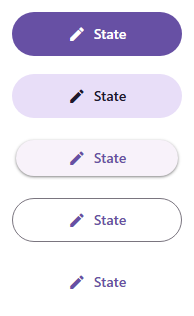
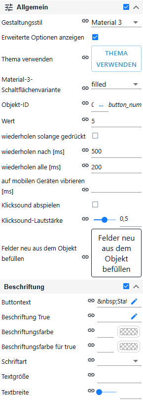
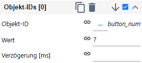
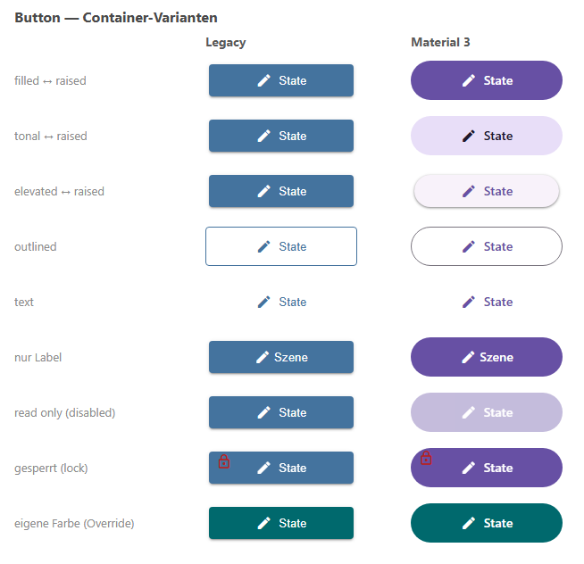
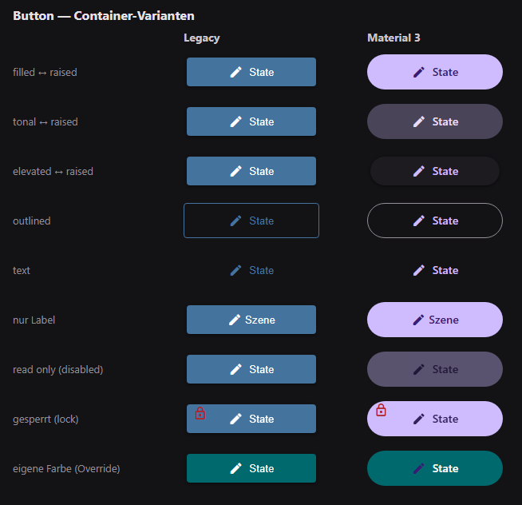

# Buttons

[Anwenderhandbuch](../README.md) › [Widget-Katalog](README.md) · [English](../../en/widgets/buttons.md)

Sechs native VIS-2-Buttonvarianten für Navigation, Links, Zustandswerte,
mehrere Zustände, numerische Addition und Ein/Aus-Umschaltung.

Template-IDs: `tplVis2-materialdesign-Button-Navigation`, `-Link`, `-State`,
`-State-Multi`, `-Adition` und `-Toggle`.

## Editor-Einstellungen

Variante im Widget-Set **Material Design** wählen, markieren und den Reiter
**WIDGET** öffnen. Die Screenshots nutzen die Varianten *State* und
*Multi State*. Nicht aufgeführte Einstellungen sind selbsterklärend.

**Allgemein** – die Aktionsfelder hängen von der Variante ab:

- **Navigation** – zu öffnende VIS-2-Zielansicht.
- **Link** – URL und *in neuem Fenster öffnen*.
- **State** – Objekt-ID und der beim Klick geschriebene Wert.
- **Addition** – *Wert* ist die Schrittweite, als Zahl ohne Vorzeichen für aufwärts und mit `-` für abwärts. *Min/Max* begrenzt das Ergebnis: `0;100` setzt beide Enden, eine einzelne Zahl begrenzt die Richtung der Schrittweite – bei `5` als Schritt ist `50` das Maximum, bei `-1` als Schritt ist `5` das Minimum. Leer heißt unbegrenzt.
- **Toggle** – *Art der Umschaltung* (`boolean` oder `value` mit eigenem *Wert für
  ein* / *Wert für aus*), *Taster* (bei Drücken und Loslassen schreiben) und *Nur
  lesen* (zeigt den Zustand, schreibt nichts). Bei `value` entscheidet *Zustand,
  wenn der Wert nicht der Bedingung 'Ein' entspricht*, wie ein dritter Wert gilt:
  `off` heißt nur der Ein-Wert schaltet an, `on` heißt alles außer dem Aus-Wert.

**Beschriftung**

- **Buttontext / Beschriftung True** – Text; im Ein-Zustand kann ein zweiter Text erscheinen.
- **Textbreite** – Breite der Beschriftung in Prozent, `0` heißt automatisch.
  Die **Ausrichtung** der [vertikalen Buttons](buttons-vertical.md) gibt es hier
  nicht; Icon links oder rechts setzt **Bildposition** in der Gruppe **Symbol**.

Die Variante **Multi State** ersetzt den einzelnen Wert durch indizierte
Objekt-/Wert-Zeilen mit jeweils eigener Verzögerung:

Die Gruppe **Symbol** nimmt einen Material-Design-Iconnamen oder eine Bildquelle
(mit eigenem **aktiven Bild** und eigener Farbe für den Ein-Zustand) und setzt
über **Bildposition** das Icon links oder rechts vom Text. **Farben**
überschreibt das Thema, **Verriegeln** verlangt einen Entsperr-Klick vor der
Aktion — beide Gruppen erscheinen erst mit dem Schalter **Erweiterte Optionen
anzeigen** in **Allgemein**. Vibration und Klickton stehen ohne eigene Gruppe
unten in **Allgemein**.

**Schaltflächenstil** (nur Stil *Klassisch*)

- **raised** – gefüllte Fläche mit Schatten.
- **unelevated** – dieselbe gefüllte Fläche ohne Schatten.
- **outlined** – nur Rahmen, Fläche transparent.
- **text** – nur Beschriftung, weder Rahmen noch Fläche.

**Material-3-Schaltflächenvariante** (nur Stil *Material 3*, an derselben Stelle)

- **filled** (Vorgabe), **tonal**, **elevated**, **outlined** und **text**. Die
  Icon-Buttons haben stattdessen die **Material-3-Icon-Schaltflächenvariante** mit
  `standard`, `filled`, `tonal` und `outlined`.

**Ein-Zustand** – *Beschriftung true*, *Beschriftungsfarbe für true*, *aktiver
Hintergrund*, *aktives Bild* und *aktive Bildfarbe* gelten, solange der Button
aktiv ist. Aktiv heißt bei *State* „das Objekt hat den geschriebenen Wert", bei
*Toggle* „eingeschaltet" und bei *Navigation* „die Zielansicht ist gerade
geöffnet" – damit lässt sich in einer Navigationsleiste die aktuelle Seite
hervorheben. *Link*, *Addition* und *Multi State* haben keinen Ein-Zustand.

**Farb-Vorrang** – dieselbe Fläche lässt sich aus zwei Gruppen einfärben, die
Farbe aus **Farben** gewinnt:

- *Primärfarbe* überschreibt *Hintergrund*, im aktiven Zustand gewinnt *aktiver Hintergrund*.
- *sekundäre Farbe* überschreibt *Bildfarbe* (und die Beschriftungsfarbe, solange keine gesetzt ist).

## Nur lesen, Verriegeln und PIN

**Nur lesen** lässt sich an einen State binden: Das Kontrollkästchen daneben und das Bindungssymbol von VIS 2 schalten das Feld auf eine Bindung um. `{0_userdata.0.automatik}` sperrt das Widget, solange der State an ist; `{a:0_userdata.0.automatik;!a}` kehrt das um und sperrt es, solange der State aus ist. Ein gebundener Text `true` oder `1` zählt als an. Gilt für die Toggle-Variante (Art Schalter und Schieber). Nur lesen gewinnt immer über die Verriegelung: Ein schreibgeschütztes Widget reagiert auf nichts und öffnet keine PIN-Tafel. Ein schreibgeschütztes Widget zeigt kein Schloss. Die Auto-Füllung setzt den Haken nur bei einem nicht beschreibbaren Objekt und überschreibt nie eine Bindung.

**PIN** (alle Widgets mit Verriegelung): 1 bis 12 Ziffern, leer heißt keine PIN. Mit PIN öffnet ein Tipp auf das verriegelte Widget eine Zifferntafel mit den Tasten 1 bis 9, Abbrechen, 0 und Löschen; sie prüft, sobald die PIN vollständig ist, wackelt bei falscher PIN und leert sich. Auch eine Hardware-Tastatur funktioniert (Ziffern, Rücktaste, Escape). Die richtige PIN entsperrt in diesem Browser alle Widgets mit derselben PIN, bis die Sperrzeit abläuft; ein Neuladen verriegelt wieder alles. Die PIN lässt sich an einen State binden, um eine zentrale PIN zu pflegen. Ist die PIN keine 1 bis 12 Ziffern lang oder eine gebundene PIN leer, bleibt das Widget verriegelt und die Tafel meldet „PIN nicht eingerichtet“. Eine eingetippte ungültige PIN markiert der Editor schon rot; korrigiere oder leere sie dort. Ein Zahlen-State verliert führende Nullen (aus 0123 wird 123); nutze für solche PINs einen Text-State. Im Editor öffnet sich die Tafel nie.

**Kein Sicherheitsmerkmal:** Die PIN steht im Klartext im Projekt und im State, und wer States schreiben darf, umgeht jede Verriegelung. Sie schützt vor versehentlichem Antippen und vor Kindern, nicht vor Angreifern.

## Gestaltungsstil

Die Stile **Klassisch** (links) und **Material 3** (rechts) nebeneinander, siehe
[Gestaltungsstil](../README.md#gestaltungsstil): die Container-Varianten filled,
tonal, elevated, outlined und text, reines Label, read only, gesperrt und eine
eigene Farbe.

Dieselben Widgets bei eingeschaltetem Dark-Theme:

