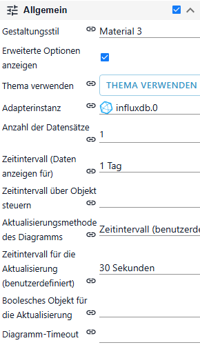
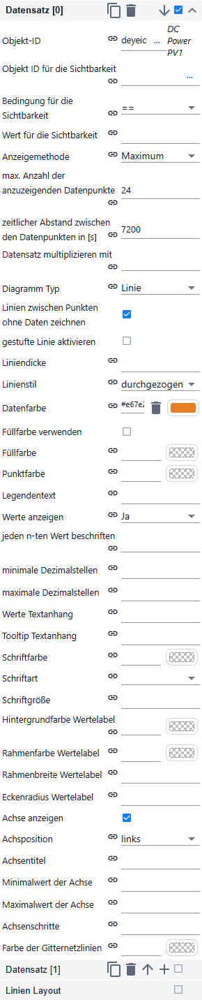
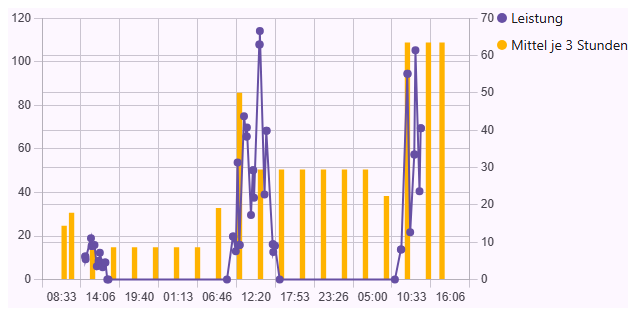
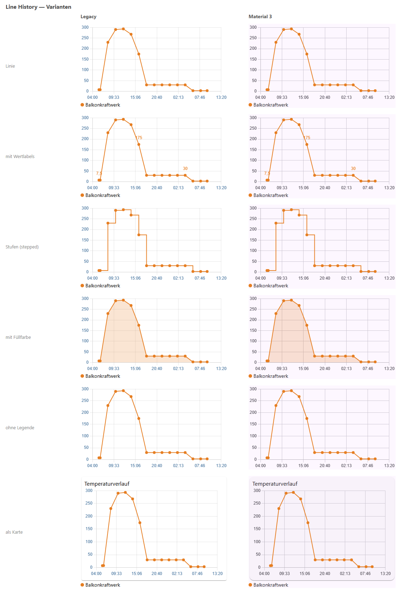
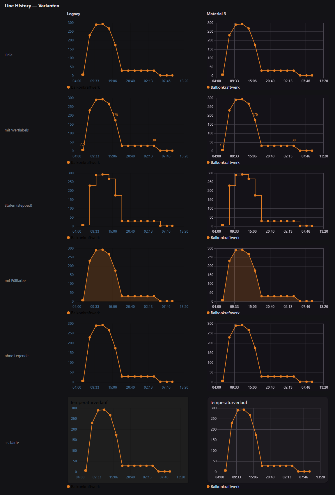

# Linienverlaufsdiagramm

[Anwenderhandbuch](../README.md) › [Widget-Katalog](README.md) › [Diagramme](charts.md) · [English](../../en/widgets/chart-line-history.md)

Lädt mehrere Zeitreihen aus einer ioBroker-History-Instanz.
Template-ID: `tplVis2-materialdesign-Chart-Line-History`.

Benötigt eine konfigurierte Instanz von History, SQL oder InfluxDB sowie für
jeden verwendeten State aktivierte Aufzeichnung.

## Zeitraum und Aktualisierung

- **History-Adapterinstanz:** Quelle aller Zeitreihen.
- **Anzuzeigender Zeitraum:** rückwirkendes Fenster bis zum aktuellen Zeitpunkt, von 30 Sekunden bis 20 Jahre.
- **Zeitraum über Objekt:** überschreibt das feste Fenster zur Laufzeit.
- **Aktualisierung:** in Echtzeit, in festem Intervall oder über ein Triggerobjekt.
- **Chart-Timeout:** maximale Wartezeit der History-Abfrage in Sekunden.

Diese Optionen liegen in der Gruppe **Allgemein**. Die Editor-Sprache folgt der
ioBroker-Systemsprache, daher sind die Screenshots deutsch.

Der State unter „Zeitraum über Objekt“ unterstützt zwei Arten von Werten:

- String: eine angebotene Intervallbezeichnung wie `30 seconds`, `10 minutes`, `1 day` oder `1 year`.
- Zahl: Startzeitpunkt als Unix-Zeitstempel in Millisekunden. Ende bleibt aktueller Zeitpunkt.

Eine Änderung des manuellen Trigger-States startet eine neue Abfrage; sein
eigener Wert ist unwichtig. Bei Intervallaktualisierung gilt mindestens eine
Sekunde, auch wenn ein kleinerer Wert konfiguriert wird.

## Datensätze und History-Abfrage

Jede indizierte Gruppe beschreibt einen aufgezeichneten State und seine
Abfrage. Darstellungsoptionen derselben Indexnummer gehören zu dieser
Zeitreihe. Ohne eigenen Legendentext wird die Objekt-ID angezeigt.

| Einstellung | Wirkung |
| --- | --- |
| Objekt-ID | State mit aktivierter History-Aufzeichnung |
| Aggregation | `minmax`, `min`, `max`, `average` oder `total` werden an die History-Instanz übergeben |
| Maximale Datenpunkte | begrenzt die zurückgelieferte Punktzahl; Standard 50 bei `minmax`, sonst 100 |
| Minimaler Zeitabstand | Abfrageschritt in Sekunden; leer oder `0` lässt die History-Instanz wählen |
| Multiplikator | rechnet jeden gültigen Wert vor der Darstellung um, etwa `0.001` von W in kW |
| Diagramm Typ | `line` (Vorgabe) oder `bar`. Balken teilen sich die Zeitachse mit den Linien, etwa der Tagesverbrauch als Balken unter einer Temperaturlinie. Sie passen zu einer Aggregation wie `total` oder `average` mit einem minimalen Zeitabstand wie `86400` (ein Balken pro Tag); mit `minmax` werden die Balken so dünn, wie die Punkte dicht liegen. Ein Balken ist in der Datensatzfarbe gefüllt, oder in der Füllfarbe, wenn eine gesetzt ist |
| Objekt ID / Bedingung / Wert für die Sichtbarkeit | blenden den Datensatz aus, solange die Bedingung nicht zutrifft, etwa eine Heizungslinie, solange `0_userdata.0.modus` nicht `auto` ist. Die Bedingung ist eine von `==` (Vorgabe), `!=`, `<`, `<=`, `>`, `>=`, `consist`, `not consist`, `exist` und `not exist`. Ohne Objekt-ID bleibt der Datensatz sichtbar. Ein ausgeblendeter Datensatz verschwindet aus der Legende, seine Y-Achse erst, wenn kein sichtbarer Datensatz sie mehr nutzt. Eine Achse, die bleibt, behält Titel, Position und Bereich ihres ersten Datensatzes, auch solange dieser ausgeblendet ist; die übrigen Linien behalten ihre Farben |

Nicht numerische und `null`-Werte werden ausgelassen. Bei einer fehlenden
History-Instanz oder nicht erreichbarer History-API bleibt das Diagramm leer.
Bei Timeouts zuerst Aufzeichnungsstatus und Zeitraum prüfen, danach den
Chart-Timeout erhöhen.

## Verlauf und Achsen

- `steppedLine` zeichnet Zustandswechsel als Stufen statt als direkte Verbindung.
- **Linienstil** zeichnet eine Linie durchgezogen, gestrichelt oder gepunktet; die Lücken wachsen mit der Linienstärke.
- **Tooltip Textanhang** in einer Datensatz-Gruppe ist die Einheit dieser Linie im Tooltip, zum Beispiel ` °C` für die eine und ` %` für die andere Linie. Leer übernimmt die Linie den Textanhang der Tooltip-Gruppe.
- Füllfarbe schattiert den Bereich unter einer Linie; ohne eigene Füllfarbe wird eine transparente Linienfarbe verwendet.
- Neu angelegte Datensätze teilen standardmäßig eine Y-Achse. Deren Position, Titel und Grenzen stammen aus der ersten Datensatzgruppe. Leere Min-/Max-Felder behalten automatische Skalierung.
- X-Achsen-Zeitformat verwendet Moment-Format-Token, beispielsweise `HH:mm` für eine 24-Stunden-Anzeige. Dasselbe Format wird auf Sekunden, Minuten, Stunden und Tage angewendet. Eine Liste mit einem Format je Einheit, wie vis-materialdesign sie gespeichert hat, zum Beispiel `{"minute":"H:mm","day":"ddd DD."}`, wird ebenfalls gelesen: Die Achse nimmt das Format der Einheit, die zum Abstand ihrer Beschriftungen passt. Bleibt das Feld leer, richtet sich die Achse ebenso nach diesem Abstand: Uhrzeit (`HH:mm`, bei Sekunden `HH:mm:ss`) unter einem Tag, das Datum in der Systemsprache ab einem Tag, Monat und Jahr ab vier Wochen, nur das Jahr ab einem Jahr. Fehlt in der Liste die passende Einheit, gilt dasselbe.
- Die Beschriftung der X-Achse hat eine eigene Farbe, Schriftart und Schriftgröße, wie die der Y-Achse. Leer gelassen gelten die Vorgaben des Diagramms.
- Tooltip-Modus `index` vergleicht Reihen am gleichen X-Wert; `nearest` zeigt den nächstgelegenen Punkt.
- Die Wertelabels an den Punkten liegen in derselben Datensatzgruppe wie die Linie, samt Hintergrund, Rahmen und Eckenradius, siehe [Werte am Diagramm](charts.md#werte-am-diagramm).

## Gestaltungsstil

Die Stile **Klassisch** (links) und **Material 3** (rechts) nebeneinander, siehe
[Gestaltungsstil](../README.md#gestaltungsstil): die einfache Linie, Wertlabels,
Stufen (stepped), Füllfarbe, ohne Legende und in einer Karte.

Dieselben Widgets bei eingeschaltetem Dark-Theme:

