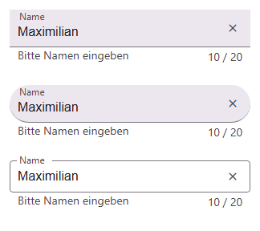
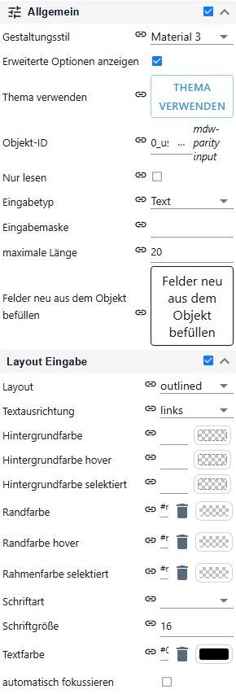
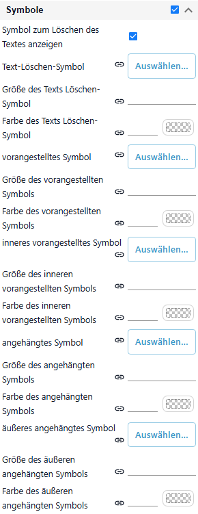
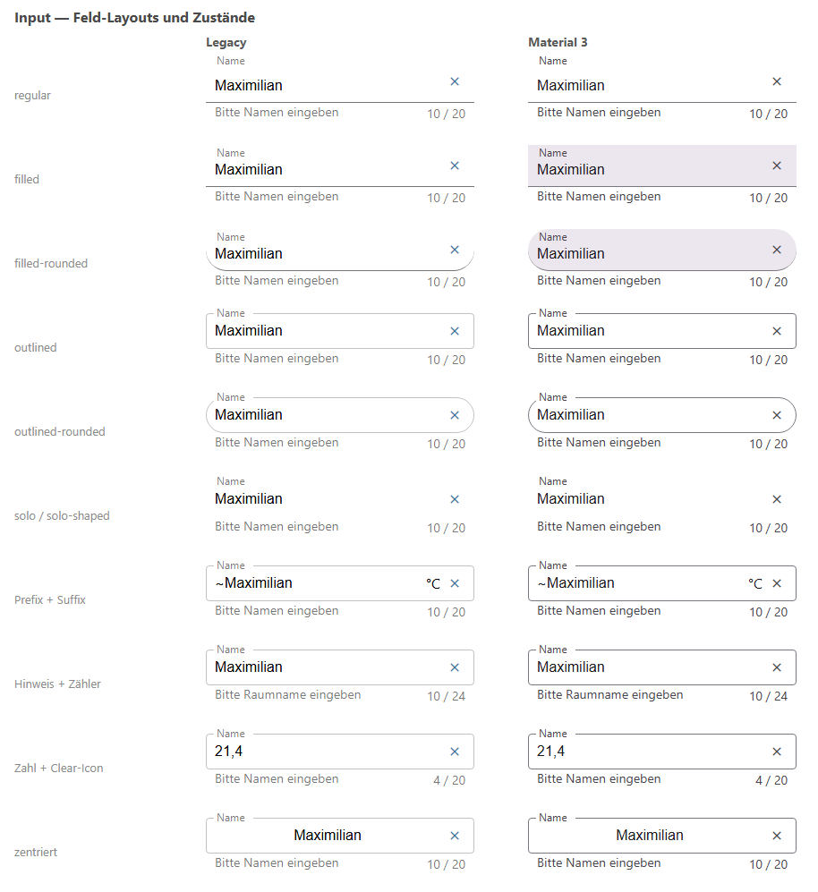
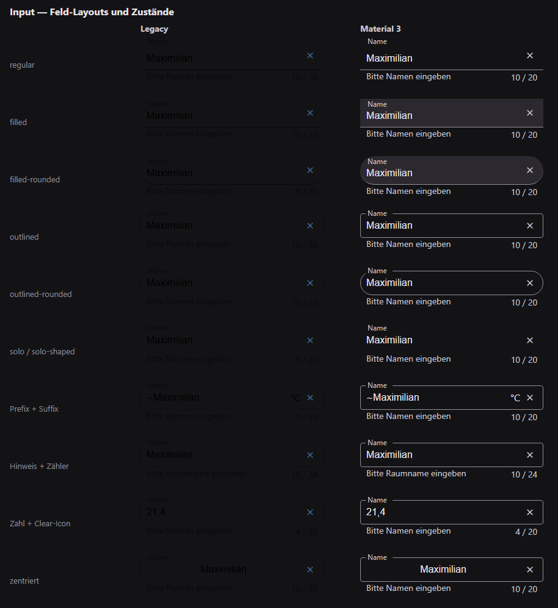

# Eingabe

[Anwenderhandbuch](../README.md) › [Widget-Katalog](README.md) · [English](../../en/widgets/input.md)

Ein natives VIS-2-Feld zur Eingabe von Text oder Zahlen.
Template-ID: `tplVis2-materialdesign-Input`.

## Editor-Einstellungen

Der Screenshot zeigt die Gruppen **Allgemein** und **Layout Eingabe**
aufgeklappt. Nicht aufgeführte Einstellungen sind selbsterklärend.

**Allgemein**

- **Objekt-ID** – der State, in den die Eingabe geschrieben wird.
- **Eingabetyp** – `Text`, `Zahl`, `Datum`, `Zeit` oder `Maske`. Bei `Zahl` wird
  eine Zahl geschrieben, sonst Text; ein leer gemachtes Zahlenfeld schreibt
  nichts, statt eine 0 in den State zu setzen.
- **Eingabemaske** – nur beim Eingabetyp `Maske`. Platzhalter: `#` Ziffer,
  `S` Buchstabe, `A` Buchstabe groß, `a` Buchstabe klein, `N` Ziffer oder
  Buchstabe, `X` beliebiges Zeichen. Jedes andere Zeichen ist ein fester
  Trenner, `##:##` ergibt also eine Uhrzeit-Eingabe.
- **maximale Länge** – begrenzt die Eingabe und liefert dem Zähler den Wert
  hinter dem Schrägstrich.
- **Auswahlhilfe** – nur bei `Datum` und `Zeit`. `Browser (nativ)` nutzt Feld und
  Auswahl des Browsers; Sprache und 12-/24-Stunden-Format bestimmt dann der Browser.
  `Material-Auswahl` zeigt den Wert im Format der Gerätesprache, das Feld bleibt mit
  passender Maske tippbar (`##.##.####` auf Deutsch, `##/##/####` auf US-Englisch),
  und das Symbol am Feldende öffnet einen Material-3-Kalender bzw. ein Zifferblatt.
  In den State kommt weiterhin `JJJJ-MM-TT` bzw. `HH:MM`.
- **Zeitformat** – bei `Zeit` mit Material-Auswahl: `Gebietsschema` (12 oder 24
  Stunden, wie die Gerätesprache es vorsieht), `24 Stunden` oder `12 Stunden`.

`Text`, `Zahl` und `Maske` schreiben beim Verlassen des Felds oder mit Enter,
`Datum` und `Zeit` sofort nach der Auswahl. Mit Material-Auswahl wird getippter Text
beim Verlassen des Felds oder mit Enter geschrieben und die Auswahl mit OK; Text, der
kein gültiges Datum bzw. keine gültige Uhrzeit ist, wird nicht geschrieben.

**Auswahlhilfe** (nur Material-Auswahl)

- **Hintergrundfarbe, Akzentfarbe, Textfarbe, Textfarbe auf Akzent** – Farben des
  Auswahldialogs. Leer gelten die Material-3-Farben des Themes. Das Kalender- bzw.
  Uhrsymbol im Feld nimmt die Farbe des **Text-Löschen-Symbols**.

**Layout Eingabe**

- **Layout** – `regular`, `solo`, `solo-rounded`, `solo-shaped`, `filled`,
  `filled-rounded`, `filled-shaped`, `outlined`, `outlined-rounded` oder
  `outlined-shaped`.
- **Textausrichtung** – `links`, `Mitte` oder `rechts` für den eingegebenen Text.
- **automatisch fokussieren** – das Feld bekommt beim Laden der Ansicht den Fokus.
- Hintergrund-, Rahmen- und Textfarben gelten je für den normalen, überfahrenen
  und ausgewählten Zustand.

**Beschriftung der Eingabe**

- **Text** – die schwebende Beschriftung über dem Feld.
- **Versatz x / Versatz y** – verschieben sie, wenn sie mit einem Symbol kollidiert.

**Anhänge der Eingabe**

- **vorangestellter Text / angehängter Text** – fester Text links bzw. rechts im
  Feld, etwa eine Einheit. Er wird nicht in den State geschrieben.

**Untertext der Eingabe**

- **Text** – Hinweiszeile unter dem Feld.
- **immer anzeigen** – abgeschaltet erscheint der Hinweis nur, solange das Feld
  den Fokus hat.

**Zählerlayout**

- **Zähler anzeigen** – zeigt unten rechts die Zeichenzahl, mit gesetzter
  **maximaler Länge** als `12 / 30`.

**Symbole**

Für das **Text-Löschen-Symbol**, das **vorangestellte**, das **innere
vorangestellte**, das **angehängte** und das **äußere angehängte Symbol** lässt
sich je ein Icon oder ein Bild samt Größe und Farbe wählen.

Für die Auswahl aus einer Werteliste nutze stattdessen das [Select](select.md)-Widget.

## Nur lesen, Verriegeln und PIN

**Nur lesen** lässt sich an einen State binden: Das Kontrollkästchen daneben und das Bindungssymbol von VIS 2 schalten das Feld auf eine Bindung um. `{0_userdata.0.automatik}` sperrt das Widget, solange der State an ist; `{a:0_userdata.0.automatik;!a}` kehrt das um und sperrt es, solange der State aus ist. Ein gebundener Text `true` oder `1` zählt als an. Neu bei **Eingabe**; ein schreibgeschütztes Feld zeigt kein Schloss. Nur lesen gewinnt immer über die Verriegelung: Ein schreibgeschütztes Widget reagiert auf nichts und öffnet keine PIN-Tafel. Die Auto-Füllung setzt den Haken nur bei einem nicht beschreibbaren Objekt und überschreibt nie eine Bindung.

**Verriegeln** (Gruppe unter **Erweiterte Optionen anzeigen**): **Verriegeln aktivieren**, **automatisch Verriegeln nach [s]** (1 s bis 24 h, Vorgabe 10), **PIN**, **Symbol** und **Symbolfarbe**. Solange es verriegelt ist, ist das Feld schreibgeschützt und zeigt am Ende ein Schloss; ein Tipp entsperrt (oder fragt die PIN ab) und setzt den Fokus ins Feld. Ein Feld mit Fokus, ein offenes Menü oder ein laufendes Ziehen wird nie unter den Fingern verriegelt; das Widget verriegelt erst, wenn das endet.

**PIN** (alle Widgets mit Verriegelung): 1 bis 12 Ziffern, leer heißt keine PIN. Mit PIN öffnet ein Tipp auf das verriegelte Widget eine Zifferntafel mit den Tasten 1 bis 9, Abbrechen, 0 und Löschen; sie prüft, sobald die PIN vollständig ist, wackelt bei falscher PIN und leert sich. Auch eine Hardware-Tastatur funktioniert (Ziffern, Rücktaste, Escape). Die richtige PIN entsperrt in diesem Browser alle Widgets mit derselben PIN, bis die Sperrzeit abläuft; ein Neuladen verriegelt wieder alles. Die PIN lässt sich an einen State binden, um eine zentrale PIN zu pflegen. Ist die PIN keine 1 bis 12 Ziffern lang oder eine gebundene PIN leer, bleibt das Widget verriegelt und die Tafel meldet „PIN nicht eingerichtet“. Eine eingetippte ungültige PIN markiert der Editor schon rot; korrigiere oder leere sie dort. Ein Zahlen-State verliert führende Nullen (aus 0123 wird 123); nutze für solche PINs einen Text-State. Im Editor öffnet sich die Tafel nie.

**Kein Sicherheitsmerkmal:** Die PIN steht im Klartext im Projekt und im State, und wer States schreiben darf, umgeht jede Verriegelung. Sie schützt vor versehentlichem Antippen und vor Kindern, nicht vor Angreifern.

## Gestaltungsstil

Die Stile **Klassisch** (links) und **Material 3** (rechts) nebeneinander, siehe
[Gestaltungsstil](../README.md#gestaltungsstil): die Layouts regular, filled,
filled-rounded, outlined, outlined-rounded und solo, Prefix/Suffix, Hinweis und
Zähler, Zahlenfeld mit Clear-Icon und zentrierten Text.

Dieselben Widgets bei eingeschaltetem Dark-Theme:

