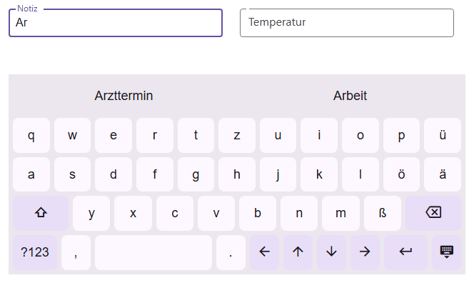
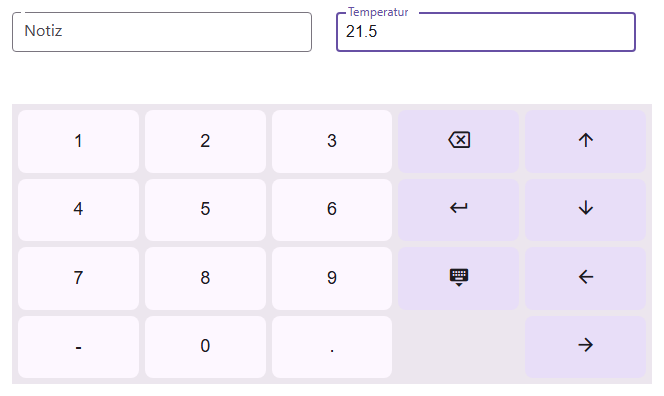
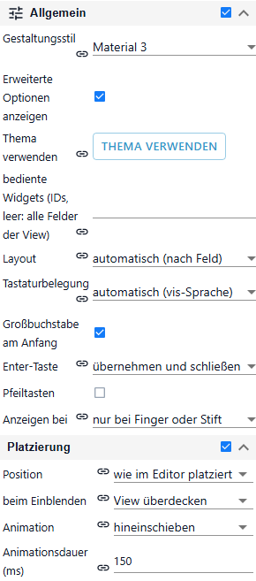
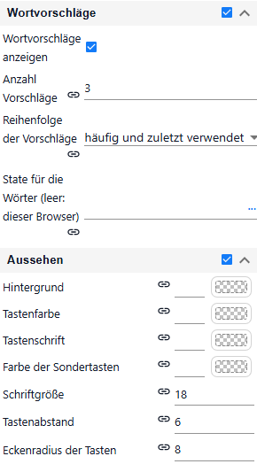
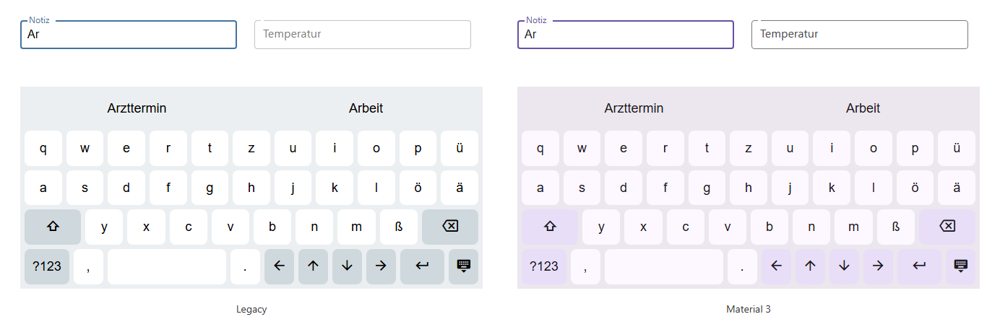
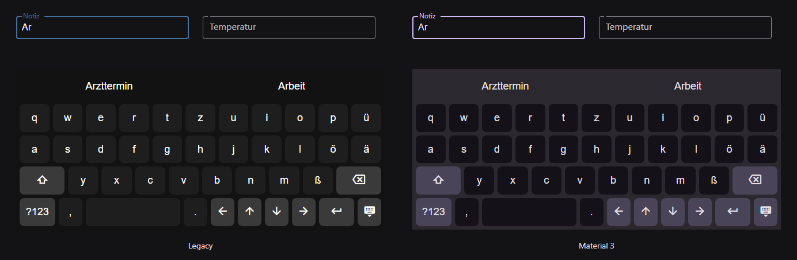

# Bildschirmtastatur

[Anwenderhandbuch](../README.md) › [Widget-Katalog](README.md) · [English](../../en/widgets/keyboard.md)

Eine Tastatur innerhalb der vis-Seite für Wandtablets, auf denen die Android-Tastatur den halben
Bildschirm verdeckt. Sie bedient die Textfelder ihrer View, hält die System-Tastatur für diese
Felder geschlossen und erscheint nur, solange eines davon den Fokus hat.
Template-ID: `tplVis2-materialdesign-Keyboard`.

Bei einem Zahlenfeld zeigt sie den Ziffernblock:

## Editor-Einstellungen

Die Editor-Oberfläche folgt der ioBroker-Systemsprache; die Screenshots sind deutsch.

**Allgemein**

- **bediente Widgets (IDs, leer: alle Felder der View)** – Widget-IDs (zum Beispiel
  `w000012 w000013`); leer bedient jedes Textfeld der View, in der die Tastatur platziert ist.
  Checkboxen, native Datums- und Zeitfelder sowie schreibgeschützte und deaktivierte Felder werden
  nie bedient.
- **Layout** – `automatisch (nach Feld)` zeigt den Ziffernblock für Zahlenfelder und Felder, die
  Ziffern verlangen (das tun die Datums- und 24-h-Zeitfelder des Eingabe-Widgets), sonst die
  Buchstaben; `Text` und `Zahlen` erzwingen eines davon.
- **Tastaturbelegung** – `automatisch (vis-Sprache)` folgt der vis-Sprache: Deutsch bekommt QWERTZ
  mit ä, ö, ü und ß, jede andere Sprache QWERTY; `Deutsch (QWERTZ)` und `Englisch (QWERTY)`
  erzwingen eine Belegung.
- **Großbuchstabe am Anfang** – die Umschalttaste ist in einem leeren Feld und nach `. `
  eingeschaltet.
- **Enter-Taste** – `übernehmen und schließen`, `zum nächsten Feld` (schließt nach dem letzten)
  oder `nur übernehmen`. Enter übernimmt auch in einem mehrzeiligen Feld und fügt keinen
  Zeilenumbruch ein. `zum nächsten Feld` folgt der Reihenfolge der Felder in der Seite (der
  Reihenfolge, in der die Widgets angelegt wurden), nicht ihrer Position auf dem Bildschirm. Enter
  sendet `keydown`, `keypress` und `keyup` mit dem Tastencode 13, damit Widgets anderer Adapter,
  die auf Enter warten (zum Beispiel die Bring-Einkaufsliste), wie auf eine echte Taste reagieren.
- **Pfeiltasten** – fügt die Tasten ← ↑ ↓ → hinzu (auf dem Ziffernblock als fünfte Spalte). ← und →
  bewegen den Cursor; ↑ und ↓ gehen durch die Liste eines Autocomplete-Widgets, in jedem anderen Feld
  springen sie an den Anfang oder das Ende. Gedrückt halten wiederholt die Taste.
- **Anzeigen bei** – `nur bei Finger oder Stift` (Standard) oder `bei jedem Fokus`. An einem PC mit Maus
  und Tastatur bleibt die Tastatur standardmäßig geschlossen, und die Felder bleiben, wie sie sind
  (Zahlenfelder behalten ihre Pfeile), bis ein Finger oder Stift den Bildschirm berührt. Ein Tipp
  in ein Feld, das den Fokus schon per Mausklick hat, öffnet die Tastatur ebenfalls.

**Platzierung**

- **Position** – `wie im Editor platziert` (das eigene Rechteck des Widgets), `unten in der View`,
  `oben in der View` (beide mit voller Breite der View und der Höhe des Widgets) oder
  `unten am Bildschirm`.
- **beim Einblenden** – `View überdecken`, `View nach oben schieben` (nur so weit, dass das Feld
  8 px über der Tastatur bleibt) oder `Platz anhängen und scrollen` (der scrollende Container
  bekommt unten Platz und scrollt das Feld ins Sichtfeld; in einer Dialog View **scrollY**
  einschalten, sonst wird der Platz abgeschnitten). Die letzten beiden wirken nur, wenn die
  Tastatur unter dem Feld liegt, sie sind also für die unteren Positionen gedacht; eine Tastatur
  oben in der View überdeckt die View, was auch gewählt ist.
- **Animation** und **Animationsdauer (ms)** (0 bis 2000) – wie die Tastatur erscheint (`keine`,
  `einblenden` oder `hineinschieben`); das Ausblenden geschieht sofort.

**Wortvorschläge**

- **Wortvorschläge anzeigen** – eine Leiste über den Tasten mit den gelernten Wörtern, schon bevor
  etwas getippt ist; solange ein Wort begonnen ist, nur Wörter, die damit beginnen. Antippen setzt
  das Wort ein und hängt ein Leerzeichen an; langes Drücken entfernt das Wort aus der Liste (für
  gelernte Tippfehler).
- **Anzahl Vorschläge** – 1 bis 10.
- **Reihenfolge der Vorschläge** – `häufig und zuletzt verwendet` (Standard): die Anzahl eines
  Wortes verliert alle 30 Tage ohne Verwendung die Hälfte ihres Gewichts, häufige Wörter stehen
  also vorn, ein früher oft, aber lange nicht mehr benutztes Wort rutscht nach hinten.
  `am häufigsten` sortiert nur nach der Anzahl, `zuletzt verwendet` nur nach der letzten
  Verwendung.
- **State für die Wörter (leer: dieser Browser)** – ein String-State, der die Liste als JSON hält und
  von allen Geräten geteilt wird, die ihn benutzen. Leer hält die Liste nur in diesem Browser.
  Wörter werden gelernt, wenn ein Feld verlassen wird oder Enter übernimmt, nie aus
  Passwortfeldern oder vom Ziffernblock, höchstens 200 Wörter mit höchstens 40 Zeichen. Wer
  Admin-Zugriff hat, kann die Wörter im State lesen.

**Aussehen** – Hintergrund, Tastenfarbe, Tastenschrift, Farbe der Sondertasten, Schriftgröße (8 bis
64), Tastenabstand (0 bis 32) und Eckenradius der Tasten (0 bis 64). Die Farbe der Sondertasten gilt
für ⇧, ⌫, ↵, ⌄, `?123`/`ABC` und die Pfeiltasten; Leertaste und Dezimaltaste sehen aus wie die
Buchstabentasten. Nicht gesetzte Farben folgen dem Material-3-Theme.

## Gestaltungsstil

Die Stile **Klassisch** (links) und **Material 3** (rechts) nebeneinander, siehe
[Gestaltungsstil](../README.md#gestaltungsstil), jeweils mit einem getippten
Wortanfang und seinen Vorschlägen. Nicht gesetzte Farben folgen dem Stil und dem
Dark-Theme.

Dieselben Tastaturen bei eingeschaltetem Dark-Theme:

## Hinweise

- Felder in anderen Views werden nicht bedient; dort ebenfalls eine Tastatur platzieren. Pro View genau eine Tastatur verwenden.
- Eine View, die in dieser View angezeigt wird (Dialog View, View in Widget), gehört zu ihr. Hat
  diese innere View eine eigene Tastatur, bedient diese die inneren Felder und diese Tastatur lässt
  sie aus, sodass nur eine Tastatur aufgeht.
- Lernen zwei Geräte im selben Moment in denselben State, kann ein Zähler verloren gehen.
