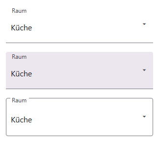
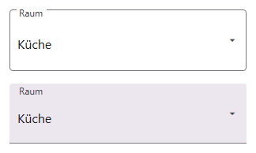
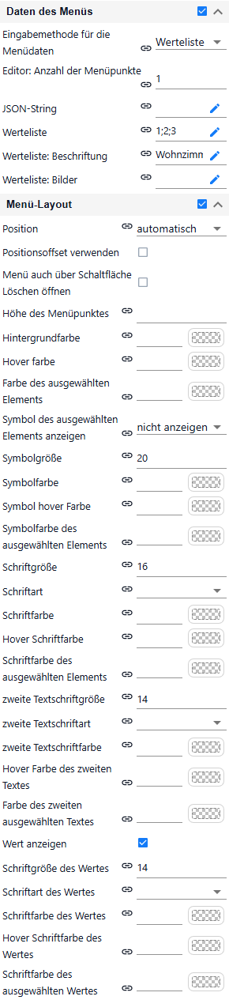
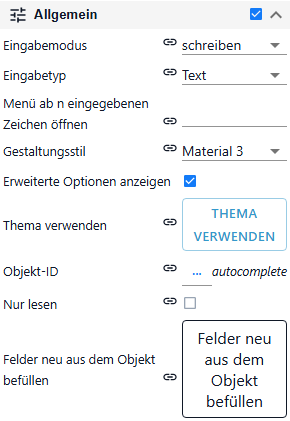
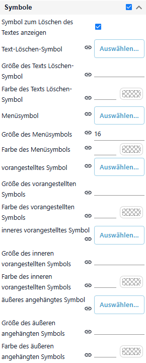
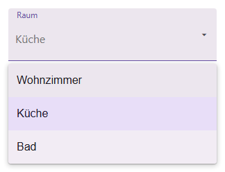
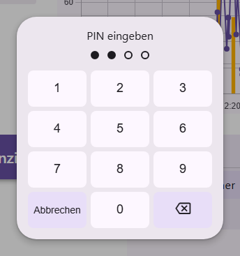
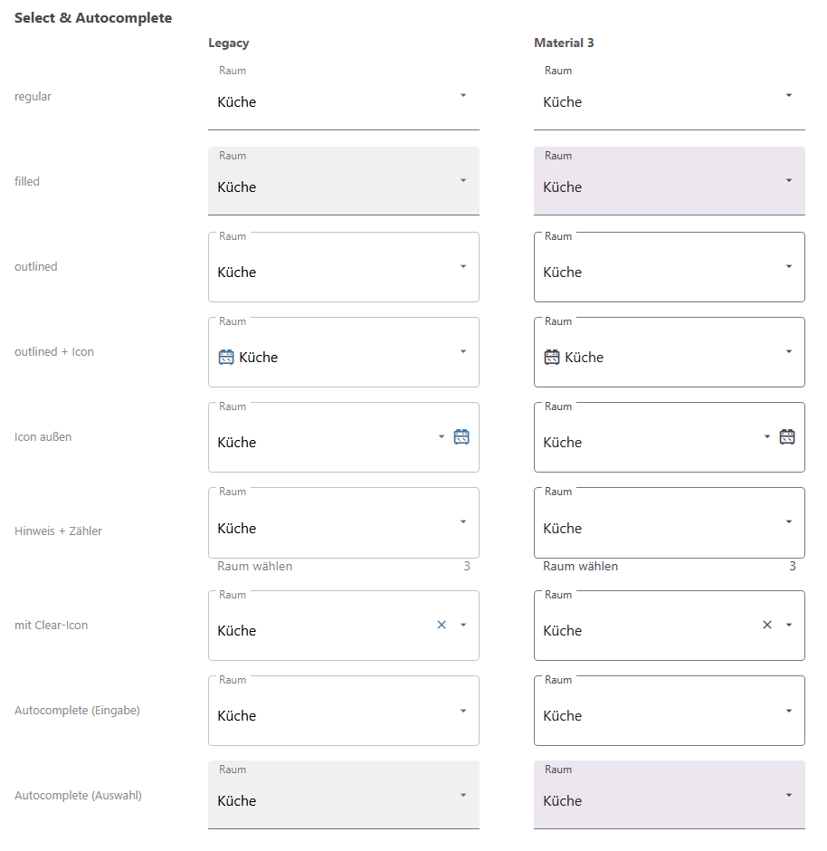
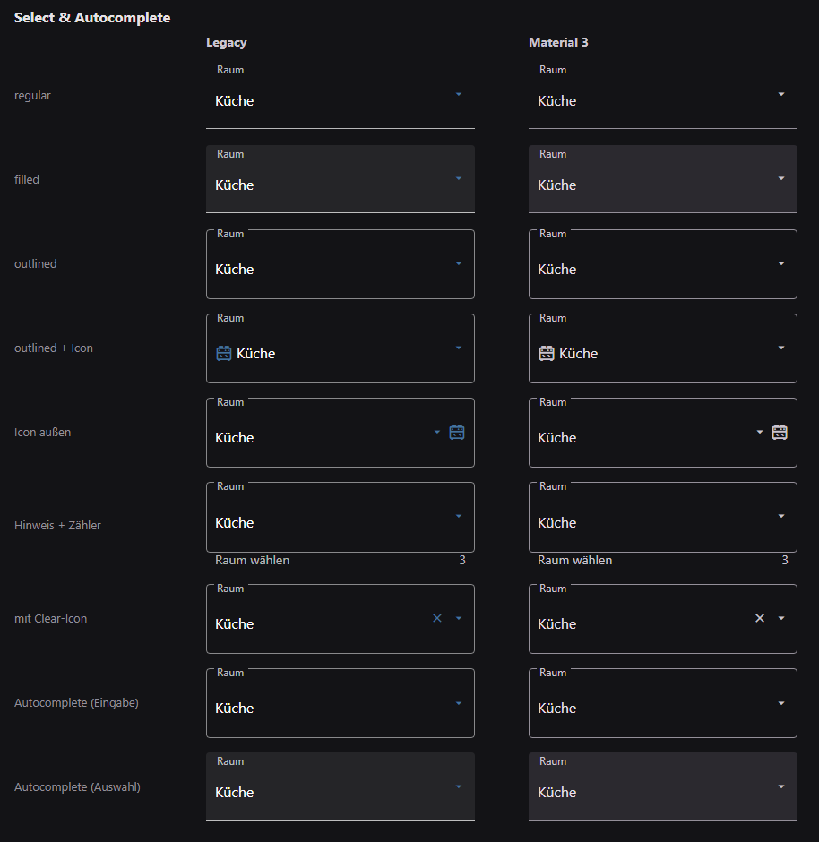

# Select und Autocomplete

[Anwenderhandbuch](../README.md) › [Widget-Katalog](README.md) · [English](../../en/widgets/select.md)

Native VIS-2-Dropdowns zur Wertauswahl. Autocomplete verhält sich wie Select,
filtert die Einträge aber zusätzlich beim Tippen.

Template-IDs: `tplVis2-materialdesign-Select` und `tplVis2-materialdesign-Autocomplete`.

Autocomplete nutzt dieselben Einstellungen, filtert die Liste aber beim Tippen —
praktisch bei langen Wertelisten wie Städten oder Titeln.

## Editor-Einstellungen

Der Screenshot zeigt die Menü-Gruppen aufgeklappt. Nicht aufgeführte
Einstellungen sind selbsterklärend.

**Allgemein**

- **Objekt-ID** – der State, in den die Auswahl geschrieben wird und aus dem der
  angezeigte Wert kommt.
- Nur Autocomplete: **Eingabemodus** – `schreiben` macht das Feld zu einem
  freien Textfeld mit Vorschlägen: Es zeigt auch einen Wert, der in keinem
  Eintrag steht, behält beim Antippen den Text zum Weiterbearbeiten und schreibt
  beim Verlassen des Felds und bei Enter genau den getippten Text in den State.
  Ein Eintrag wird nur übernommen, wenn er angetippt oder mit den Pfeiltasten
  markiert ist oder sein Text dem getippten Text entspricht (Groß-/Kleinschreibung
  egal). Wer das Feld nur antippt und wieder verlässt, schreibt nichts.
  `auswählen` übernimmt nur Einträge der Liste und verwirft freien Text.
- Nur Autocomplete: **Eingabetyp** – `Text`, `Datum` oder `Zeit` für das
  Eingabefeld.
- Nur Autocomplete: **Menü ab n eingegebenen Zeichen öffnen** – das Menü öffnet
  sich erst, wenn so viele Zeichen getippt sind. `0` (Standard) öffnet es schon
  beim Antippen. Die Pfeiltasten öffnen es immer.

**Daten des Menüs**

- **Eingabemethode für die Menüdaten** – `über den Editor` (indizierte Gruppen
  **Menüpunkt [n]**), `JSON-String`, `Objekt hat Werteliste` (die `states` des
  Objekts aus der Objekt-ID) oder `Werteliste`.
- **Editor: Anzahl der Menüpunkte** – wie viele indizierte Gruppen **Menüpunkt [n]**
  es gibt.
- **Werteliste / Werteliste: Beschriftung / Werteliste: Bilder** – drei
  semikolongetrennte Listen, die zeilenweise zusammengehören, z. B. Werte
  `1;2;3`, Beschriftungen `Wohnzimmer;Küche;Bad`, Bilder
  `sofa;silverware-fork-knife;shower`. Ohne Beschriftung steht der Wert selbst da.
- **JSON-String** – ein Array von Objekten mit `value`, `text`, `subText`,
  `icon`, `iconColor` und `iconColorSelectedTextField`. Ein Eintrag ohne `value`
  wird übersprungen, ohne `text` steht der Wert da.

**Menü-Layout**

- **Position / Positionsoffset verwenden** – ob das Menü `auto`, `top` oder
  `bottom` öffnet.
- **Menü auch über Schaltfläche Löschen öffnen** – nach dem Löschen des Werts
  öffnet sich die Liste erneut.
- **Symbol des ausgewählten Elements anzeigen** – wo im Eingabefeld das Symbol
  des gewählten Eintrags erscheint: `nicht anzeigen`, `prepend`, `prepend-inner`
  oder `append-outer`. Es ersetzt dort das fest eingestellte Symbol.
- **Wert anzeigen** – zeigt in jeder Menüzeile zusätzlich den Wert rechts neben
  dem Text.
- Zeilenhöhe, Schriften und Farben der Liste gelten je für den normalen,
  überfahrenen und ausgewählten Zustand.

Das offene Menü liegt über der ganzen Seite: Ein Dialog, eine View oder ein
Widget mit abgeschnittenem Rand verdeckt es nicht. Es bleibt am Feld, auch beim
Scrollen und nachdem die [Bildschirmtastatur](keyboard.md) die View verschoben
hat, und wird höchstens so hoch wie der Platz bis zum Fensterrand (höchstens
300 px). Das Select schließt sein Menü auch bei einem Tipp außerhalb von Feld
und Menü, das Autocomplete beim Verlassen des Felds. In einer per CSS skalierten
View wird das Menü nicht mitskaliert.

**Menüpunkt [n]**

Die Gruppen erscheinen nur bei der Methode `über den Editor`.

- **Wert** – was in den State geschrieben wird. Bleibt er leer, wird die
  **Beschriftung** geschrieben.
- **Beschriftung / zweiter Text** – die beiden Textzeilen des Eintrags.
- **Symbol / Symbolfarbe** – Symbol der Menüzeile.
- **Symbolfarbe ausgewählt für das Textfeld** – Farbe desselben Symbols, wenn es
  als gewählter Eintrag im Eingabefeld steht.

Die Gruppe **Layout Eingabe** (`regular`, `solo`, `solo-rounded`, `solo-shaped`,
`filled`, `filled-rounded`, `filled-shaped`, `outlined`, `outlined-rounded`,
`outlined-shaped`) entspricht dem [Eingabe](input.md)-Widget, ebenso
**Beschriftung der Eingabe**, **Anhänge der Eingabe**, **Untertext der Eingabe**
und **Zählerlayout**.

**Symbole**

Für das **Text-Löschen-Symbol**, das **Menüsymbol** (Aufklapp-Pfeil), das
**vorangestellte**, das **innere vorangestellte** und das **äußere angehängte
Symbol** lässt sich je ein Icon oder ein Bild samt Größe und Farbe wählen.

## Tastatur (Autocomplete)

Der Fokus bleibt im Eingabefeld; die Liste wird mit einer Markierung bedient.

- **↓ / ↑** – öffnet das Menü und bewegt die Markierung; am Ende geht es oben
  wieder los.
- **Enter** – übernimmt den markierten Eintrag. Ohne Markierung schreibt
  `schreiben` den getippten Text, `auswählen` den ersten passenden Eintrag.
- **Tab** – übernimmt den markierten Eintrag und springt weiter.
- **Escape** – schließt das Menü und verwirft den getippten Text; der Wert bleibt. Ein Dialog um das Widget bleibt dabei offen; erst ein weiteres Escape erreicht ihn.

Während eine Bildschirmtastatur ein Wort noch zusammensetzt, lösen Enter und Tab
nichts aus. Findet der getippte Text keinen Eintrag, bleibt das Menü zu.

## Nur lesen, Verriegeln und PIN

**Nur lesen** lässt sich an einen State binden: Das Kontrollkästchen daneben und das Bindungssymbol von VIS 2 schalten das Feld auf eine Bindung um. `{0_userdata.0.automatik}` sperrt das Widget, solange der State an ist; `{a:0_userdata.0.automatik;!a}` kehrt das um und sperrt es, solange der State aus ist. Ein gebundener Text `true` oder `1` zählt als an. **Select** und **Autocomplete** zeigen bei Nur lesen kein Schloss. Nur lesen gewinnt immer über die Verriegelung: Ein schreibgeschütztes Widget reagiert auf nichts und öffnet keine PIN-Tafel. Die Auto-Füllung setzt den Haken nur bei einem nicht beschreibbaren Objekt und überschreibt nie eine Bindung.

**Verriegeln** (Gruppe unter **Erweiterte Optionen anzeigen**): **Verriegeln aktivieren**, **automatisch Verriegeln nach [s]** (1 s bis 24 h, Vorgabe 10), **PIN**, **Symbol** und **Symbolfarbe**. Select öffnet sein Menü nach dem Entsperren, Autocomplete setzt den Fokus ins Feld. Ein Feld mit Fokus, ein offenes Menü oder ein laufendes Ziehen wird nie unter den Fingern verriegelt; das Widget verriegelt erst, wenn das endet.

**PIN** (alle Widgets mit Verriegelung): 1 bis 12 Ziffern, leer heißt keine PIN. Mit PIN öffnet ein Tipp auf das verriegelte Widget eine Zifferntafel mit den Tasten 1 bis 9, Abbrechen, 0 und Löschen; sie prüft, sobald die PIN vollständig ist, wackelt bei falscher PIN und leert sich. Auch eine Hardware-Tastatur funktioniert (Ziffern, Rücktaste, Escape). Die richtige PIN entsperrt in diesem Browser alle Widgets mit derselben PIN, bis die Sperrzeit abläuft; ein Neuladen verriegelt wieder alles. Die PIN lässt sich an einen State binden, um eine zentrale PIN zu pflegen. Ist die PIN keine 1 bis 12 Ziffern lang oder eine gebundene PIN leer, bleibt das Widget verriegelt und die Tafel meldet „PIN nicht eingerichtet“. Eine eingetippte ungültige PIN markiert der Editor schon rot; korrigiere oder leere sie dort. Ein Zahlen-State verliert führende Nullen (aus 0123 wird 123); nutze für solche PINs einen Text-State. Im Editor öffnet sich die Tafel nie.

**Kein Sicherheitsmerkmal:** Die PIN steht im Klartext im Projekt und im State, und wer States schreiben darf, umgeht jede Verriegelung. Sie schützt vor versehentlichem Antippen und vor Kindern, nicht vor Angreifern.

## Gestaltungsstil

Die Stile **Klassisch** (links) und **Material 3** (rechts) nebeneinander, siehe
[Gestaltungsstil](../README.md#gestaltungsstil): die Layouts regular, filled und
outlined, Einträge mit Symbolen, Wert-Spalte, Clear-Icon sowie Autocomplete
während der Eingabe und nach der Auswahl.

Dieselben Widgets bei eingeschaltetem Dark-Theme:

