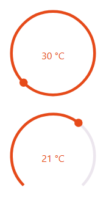
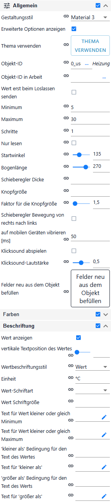
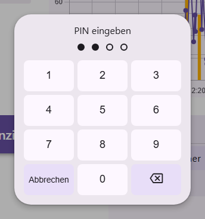
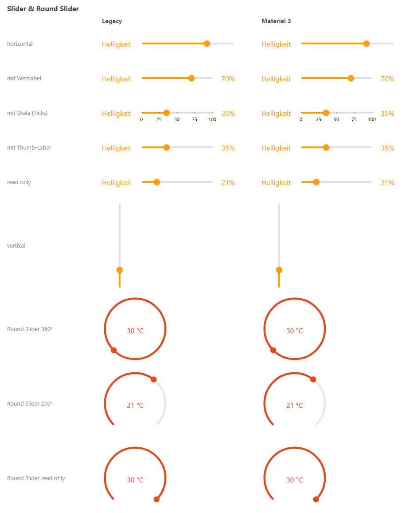
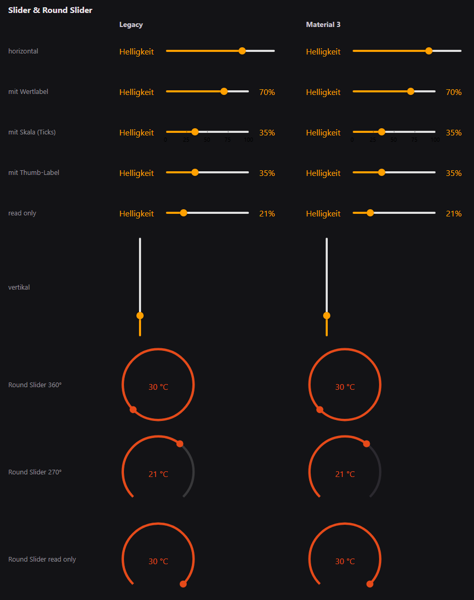

# Runder Slider

[Anwenderhandbuch](../README.md) › [Widget-Katalog](README.md) · [English](../../en/widgets/slider-round.md)

Kreisförmiger nativer VIS-2-Slider für numerische Zustände. Template-ID:
`tplVis2-materialdesign-Slider-Round`.

## Editor-Einstellungen

Der Screenshot zeigt die Gruppen **Allgemein** und **Beschriftung** aufgeklappt.
Nicht aufgeführte Einstellungen sind selbsterklärend.

**Allgemein**

- **Objekt-ID** – Wert-State; **Objekt-ID in Arbeit** sperrt den Slider, solange
  dieser State meldet, dass das Gerät noch anfährt.
- **Minimum / Maximum / Schritte** – Wertebereich und Schrittweite (Vorgabe 1).
- **Wert erst beim Loslassen senden** – schreibt einmal am Ende der Bewegung
  statt fortlaufend beim Ziehen; der Knopf folgt so oder so dem Finger.
- **Startwinkel / Bogenlänge** – wo die kreisförmige Spur beginnt (Vorgabe 135°)
  und über wie viele Grad sie läuft (Vorgabe 270°).
- **Schieberegler Dicke** (Vorgabe 3) und **Knopfgröße** (Vorgabe 6) zählen in
  Prozent der Widget-Kantenlänge, nicht in Pixeln — die Zeichnung liegt in einem
  100×100-Raster.
- **Faktor für die Knopfgröße** – multipliziert die Knopfgröße dauerhaft,
  Vorgabe 1,5.
- **Schieberegler Bewegung von rechts nach links** – kehrt die Richtung um.
- **Nur lesen** – zeigt den Wert an, nimmt aber keine Eingabe an.

**Beschriftung**

- **Wert anzeigen** – Wertlabel in der Mitte, Vorgabe an; **vertikale
  Textposition des Wertes** verschiebt es nach oben oder unten.
- **Wertbeschriftungsstil / Einheit** – **Wert** hängt die Einheit an den
  Rohwert, **Prozent** zeigt stattdessen den abgerundeten Prozentwert; die
  Einheit entfällt dabei.
- **Text für Wert kleiner oder gleich Minimum** greift ab dem Minimum,
  **Text für Wert kleiner oder gleich Maximum** trotz seiner Beschriftung ab dem
  **Maximum**.
- **'kleiner als' Bedingung für den Text des Wertes** / **Text für 'kleiner
  als'** – der Text erscheint zwischen Minimum (ausschließlich) und dieser
  Grenze (einschließlich); **'größer als' Bedingung für den Text des Werts** /
  **Text für 'größer als'** entsprechend ab dieser Grenze bis unter das Maximum.

Die Gruppe **Farben** (**Hintergrund**, **Farbe vor dem Regler**, **Farbe des
Reglers**, **Farbe nach Regler**, **Textfarbe des Wertes**) erscheint erst, wenn
in **Allgemein** der Schalter **Erweiterte Optionen anzeigen** gesetzt ist.

## Nur lesen, Verriegeln und PIN

**Nur lesen** lässt sich an einen State binden: Das Kontrollkästchen daneben und das Bindungssymbol von VIS 2 schalten das Feld auf eine Bindung um. `{0_userdata.0.automatik}` sperrt das Widget, solange der State an ist; `{a:0_userdata.0.automatik;!a}` kehrt das um und sperrt es, solange der State aus ist. Ein gebundener Text `true` oder `1` zählt als an. Neu ist die Bindung; der runde Slider zeigt bei Nur lesen kein Schloss. Nur lesen gewinnt immer über die Verriegelung: Ein schreibgeschütztes Widget reagiert auf nichts und öffnet keine PIN-Tafel. Die Auto-Füllung setzt den Haken nur bei einem nicht beschreibbaren Objekt und überschreibt nie eine Bindung.

**Verriegeln** (Gruppe unter **Erweiterte Optionen anzeigen**): **Verriegeln aktivieren**, **automatisch Verriegeln nach [s]** (1 s bis 24 h, Vorgabe 10), **PIN**, **Symbol** und **Symbolfarbe**. Ein Tipp entsperrt, ohne den Knopf zu bewegen. Ein laufendes Ziehen wird nie unter den Fingern verriegelt; das Widget verriegelt erst, wenn es endet.

**PIN** (alle Widgets mit Verriegelung): 1 bis 12 Ziffern, leer heißt keine PIN. Mit PIN öffnet ein Tipp auf das verriegelte Widget eine Zifferntafel mit den Tasten 1 bis 9, Abbrechen, 0 und Löschen; sie prüft, sobald die PIN vollständig ist, wackelt bei falscher PIN und leert sich. Auch eine Hardware-Tastatur funktioniert (Ziffern, Rücktaste, Escape). Die richtige PIN entsperrt in diesem Browser alle Widgets mit derselben PIN, bis die Sperrzeit abläuft; ein Neuladen verriegelt wieder alles. Die PIN lässt sich an einen State binden, um eine zentrale PIN zu pflegen. Ist die PIN keine 1 bis 12 Ziffern lang oder eine gebundene PIN leer, bleibt das Widget verriegelt und die Tafel meldet „PIN nicht eingerichtet“. Eine eingetippte ungültige PIN markiert der Editor schon rot; korrigiere oder leere sie dort. Ein Zahlen-State verliert führende Nullen (aus 0123 wird 123); nutze für solche PINs einen Text-State. Im Editor öffnet sich die Tafel nie.

**Kein Sicherheitsmerkmal:** Die PIN steht im Klartext im Projekt und im State, und wer States schreiben darf, umgeht jede Verriegelung. Sie schützt vor versehentlichem Antippen und vor Kindern, nicht vor Angreifern.

## Gestaltungsstil

Die Stile **Klassisch** (links) und **Material 3** (rechts) nebeneinander, siehe
[Gestaltungsstil](../README.md#gestaltungsstil): den horizontalen Slider mit
Wertlabel, Skala und Thumb-Label, read only, vertikal sowie den runden Slider
mit 360° und 270° und read only.

Dieselben Widgets bei eingeschaltetem Dark-Theme:

