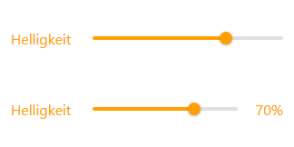
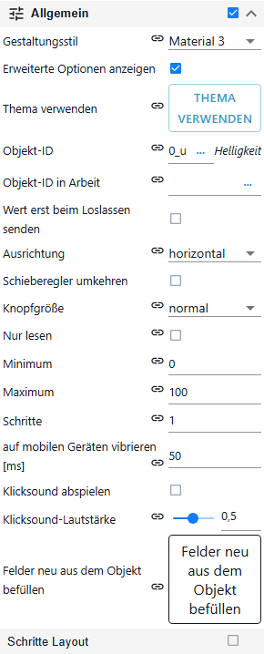
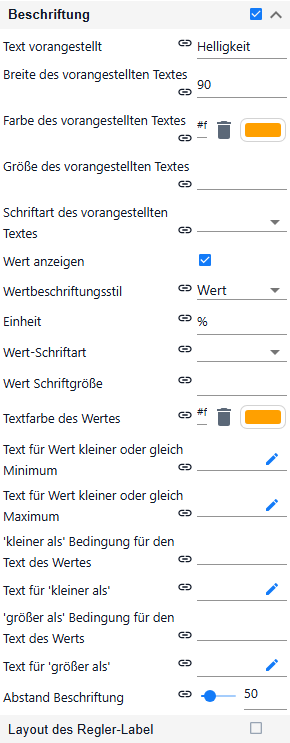
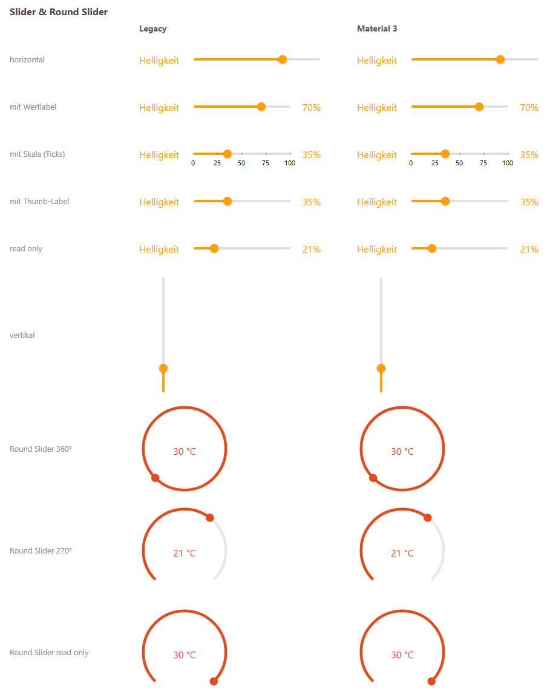
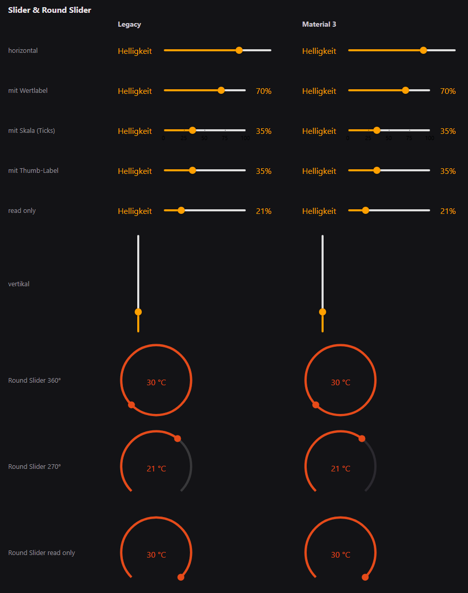

# Slider

[Anwenderhandbuch](../README.md) › [Widget-Katalog](README.md) · [English](../../en/widgets/slider.md)

Horizontaler oder vertikaler nativer VIS-2-Slider für numerische Zustände.
Template-ID: `tplVis2-materialdesign-Slider`.

## Editor-Einstellungen

Die Screenshots zeigen die Gruppen, die Verhalten und Beschriftung bestimmen.
Nicht aufgeführte Einstellungen sind selbsterklärend.

**Allgemein**

- **oid** – der Wert-State; **Objekt-ID in Arbeit** meldet optional, dass ein Gerät die Zielposition noch anfährt.
- **Ausrichtung** (`horizontal`, `vertikal`) und **Schieberegler umkehren** – invertierte Richtung.
- **Min / Max / Schritt** – Wertebereich und Schrittweite, Vorgaben 0, 100 und 1. Sind Min und Max gleich, rechnet das Widget mit Min + 100.
- **Nur lesen** – zeigt den Wert an, schreibt aber nie.
- **Wert erst beim Loslassen senden** – schreibt nicht während des Ziehens, sondern einmal am Ende.
- **Knopfgröße** – `normal`, `Wurschtfinger` oder `große Wurschtfinger`, für die Bedienung am Touchscreen.

**Schritte Layout (Teilstriche)**

- **Schritte anzeigen** – `nicht anzeigen`, `anzeigen bei Bedienung` oder `immer anzeigen`.
- **Text der Schritte (durch Kommas getrennt)** – die Beschriftungen der Teilstriche, z. B. `aus, halb, voll`. Die Anzahl der Texte bestimmt zugleich, wie viele Teilstriche gezeichnet werden; ohne Texte ergibt sie sich aus Min, Max und Schritt.

**Beschriftung**

- **Text vorangestellt** – Beschriftung links vom Slider, mit eigener Breite, Farbe und Schrift.
- **Wert anzeigen** (Vorgabe an), **Wertbeschriftungsstil** (`Wert` oder `Prozent`) und **Einheit** – die Zahl neben dem Slider. **Abstand Beschriftung** ist ihre Breite in Pixel (Vorgabe 50).
- **Text für Wert kleiner oder gleich Minimum / Maximum** – fester Text an den beiden Enden statt der Zahl. Das zweite Feld greift am Maximum; die Beschriftung im Editor ist irreführend.
- **'kleiner als' Bedingung für den Text des Wertes** / **Text für 'kleiner als'** und das Gegenstück für „größer als“ – ersetzen die Zahl unterhalb bzw. oberhalb einer Grenze, z. B. „aus“ unter 1.

**Layout des Regler-Label**

- **Label anzeigen** – `nicht anzeigen`, `anzeigen bei Bedienung` oder `immer anzeigen`.
- **benutze Regeln der Beschriftung** – das Regler-Label übernimmt dieselben Ersatztexte wie die Wertbeschriftung; ohne den Schalter zeigt es immer die nackte Zahl.
- Größe, Hintergrund- und Schriftfarben des Reglers folgen.

## Nur lesen, Verriegeln und PIN

**Nur lesen** lässt sich an einen State binden: Das Kontrollkästchen daneben und das Bindungssymbol von VIS 2 schalten das Feld auf eine Bindung um. `{0_userdata.0.automatik}` sperrt das Widget, solange der State an ist; `{a:0_userdata.0.automatik;!a}` kehrt das um und sperrt es, solange der State aus ist. Ein gebundener Text `true` oder `1` zählt als an. Neu ist die Bindung; der Slider zeigt bei Nur lesen kein Schloss. Nur lesen gewinnt immer über die Verriegelung: Ein schreibgeschütztes Widget reagiert auf nichts und öffnet keine PIN-Tafel. Die Auto-Füllung setzt den Haken nur bei einem nicht beschreibbaren Objekt und überschreibt nie eine Bindung.

**Verriegeln** (Gruppe unter **Erweiterte Optionen anzeigen**): **Verriegeln aktivieren**, **automatisch Verriegeln nach [s]** (1 s bis 24 h, Vorgabe 10), **PIN**, **Symbol** und **Symbolfarbe**. Neu für den Slider. Ein Tipp entsperrt, ohne den Knopf zu bewegen. Ein laufendes Ziehen wird nie unter den Fingern verriegelt; das Widget verriegelt erst, wenn es endet.

**PIN** (alle Widgets mit Verriegelung): 1 bis 12 Ziffern, leer heißt keine PIN. Mit PIN öffnet ein Tipp auf das verriegelte Widget eine Zifferntafel mit den Tasten 1 bis 9, Abbrechen, 0 und Löschen; sie prüft, sobald die PIN vollständig ist, wackelt bei falscher PIN und leert sich. Auch eine Hardware-Tastatur funktioniert (Ziffern, Rücktaste, Escape). Die richtige PIN entsperrt in diesem Browser alle Widgets mit derselben PIN, bis die Sperrzeit abläuft; ein Neuladen verriegelt wieder alles. Die PIN lässt sich an einen State binden, um eine zentrale PIN zu pflegen. Ist die PIN keine 1 bis 12 Ziffern lang oder eine gebundene PIN leer, bleibt das Widget verriegelt und die Tafel meldet „PIN nicht eingerichtet“. Eine eingetippte ungültige PIN markiert der Editor schon rot; korrigiere oder leere sie dort. Ein Zahlen-State verliert führende Nullen (aus 0123 wird 123); nutze für solche PINs einen Text-State. Im Editor öffnet sich die Tafel nie.

**Kein Sicherheitsmerkmal:** Die PIN steht im Klartext im Projekt und im State, und wer States schreiben darf, umgeht jede Verriegelung. Sie schützt vor versehentlichem Antippen und vor Kindern, nicht vor Angreifern.

## Gestaltungsstil

Die Stile **Klassisch** (links) und **Material 3** (rechts) nebeneinander, siehe
[Gestaltungsstil](../README.md#gestaltungsstil): den horizontalen Slider mit
Wertlabel, Skala und Thumb-Label, read only, vertikal sowie den runden Slider
mit 360° und 270° und read only.

Dieselben Widgets bei eingeschaltetem Dark-Theme:

