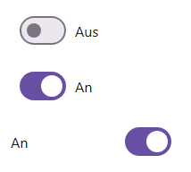
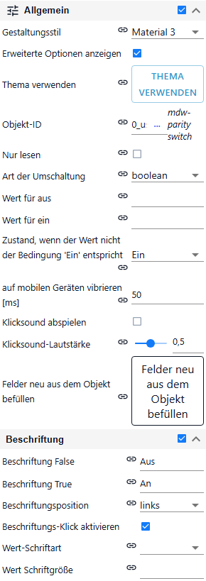
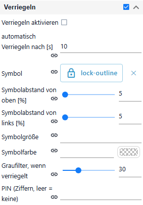
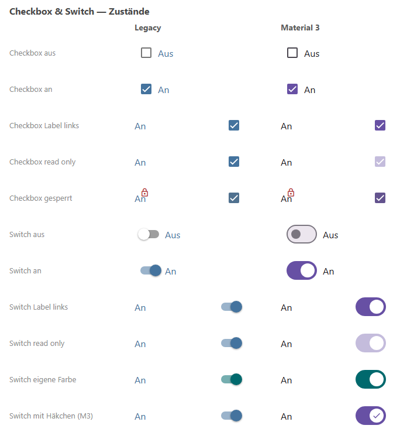
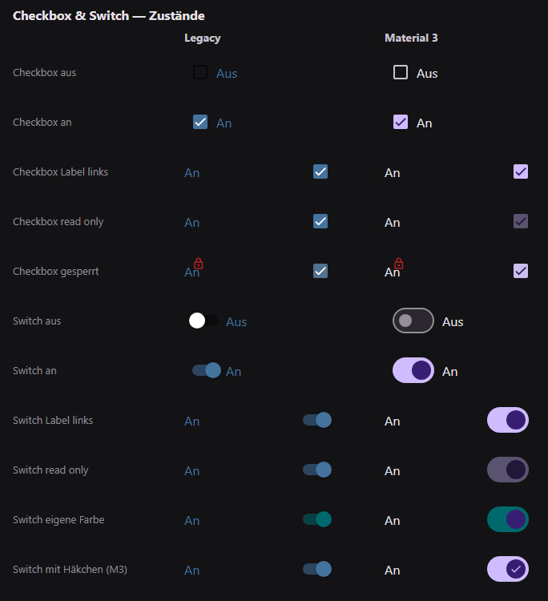

# Switch

[Anwenderhandbuch](../README.md) › [Widget-Katalog](README.md) · [English](../../en/widgets/switch.md)

Ein nativer Material-Design-Schalter für VIS 2, der boolesche oder eigene
Aus-/Ein-Werte liest und schreibt. Template-ID: `tplVis2-materialdesign-Switch`.

## Editor-Einstellungen

Der Screenshot zeigt die relevanten Gruppen (**Allgemein** und
**Beschriftung**) aufgeklappt. Nicht aufgeführte Einstellungen sind
selbsterklärend.

**Allgemein**

- **Art der Umschaltung** – `boolean` schreibt `true`/`false`; `value` schreibt stattdessen die Werte **Wert für aus** / **Wert für ein**.
- **Zustand, wenn der Wert nicht der Bedingung 'Ein' entspricht** – welcher Zustand (an/aus) angezeigt wird, wenn der gelesene Wert weder zum Aus- noch zum Ein-Wert passt.
- **auf mobilen Geräten vibrieren [s]** – haptische Rückmeldung beim Drücken (nur mobil).
- **Klicksound-Lautstärke** – Lautstärke des Klicksounds, wenn *Klicksound abspielen* aktiv ist.
- **Nur lesen** – zeigt den Zustand an, schreibt aber nie.

**Beschriftung**

- **Beschriftung False / True** – Text neben dem Schalter im Aus- / Ein-Zustand.
- **Beschriftungsposition** – links, rechts oder aus.
- **Beschriftungs-Klick aktivieren** – ein Klick auf die Beschriftung schaltet den Wert um, nicht nur der Schalter.

**Farben** steuert Thumb, Track, Aktiv- und Hoverfarben; im Stil Material 3
kommt dort **Material-3-Schalter mit Häkchen** dazu, das ein Häkchen in den
eingeschalteten Griff zeichnet. **Verriegeln** ergänzt
Entsperren und eine automatische Wiederverriegelung; für das **Symbol** lässt
sich ein Icon oder ein Bild auswählen.

## Nur lesen, Verriegeln und PIN

**Nur lesen** lässt sich an einen State binden: Das Kontrollkästchen daneben und das Bindungssymbol von VIS 2 schalten das Feld auf eine Bindung um. `{0_userdata.0.automatik}` sperrt das Widget, solange der State an ist; `{a:0_userdata.0.automatik;!a}` kehrt das um und sperrt es, solange der State aus ist. Ein gebundener Text `true` oder `1` zählt als an.  Nur lesen gewinnt immer über die Verriegelung: Ein schreibgeschütztes Widget reagiert auf nichts und öffnet keine PIN-Tafel. Die Auto-Füllung setzt den Haken nur bei einem nicht beschreibbaren Objekt und überschreibt nie eine Bindung.

**PIN** (alle Widgets mit Verriegelung): 1 bis 12 Ziffern, leer heißt keine PIN. Mit PIN öffnet ein Tipp auf das Schloss eine Zifferntafel mit den Tasten 1 bis 9, Abbrechen, 0 und Löschen; sie prüft, sobald die PIN vollständig ist, wackelt bei falscher PIN und leert sich. Auch eine Hardware-Tastatur funktioniert (Ziffern, Rücktaste, Escape). Die richtige PIN entsperrt in diesem Browser alle Widgets mit derselben PIN, bis die Sperrzeit abläuft; ein Neuladen verriegelt wieder alles. Die PIN lässt sich an einen State binden, um eine zentrale PIN zu pflegen. Ist die gebundene PIN leer oder keine 1 bis 12 Ziffern lang, bleibt das Widget verriegelt und die Tafel meldet „PIN nicht eingerichtet“. Ein Zahlen-State verliert führende Nullen (aus 0123 wird 123); nutze für solche PINs einen Text-State. Im Editor öffnet sich die Tafel nie.

**Kein Sicherheitsmerkmal:** Die PIN steht im Klartext im Projekt und im State, und wer States schreiben darf, umgeht jede Verriegelung. Sie schützt vor versehentlichem Antippen und vor Kindern, nicht vor Angreifern.

## Gestaltungsstil

Die Stile **Klassisch** (links) und **Material 3** (rechts) nebeneinander, siehe
[Gestaltungsstil](../README.md#gestaltungsstil): Checkbox und Switch: aus, an,
Label links, read only, gesperrt, eigene Farbe und das Material-3-Häkchen im
Switch-Griff.

Dieselben Widgets bei eingeschaltetem Dark-Theme:

