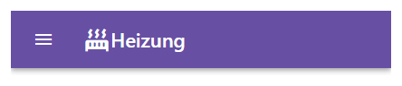
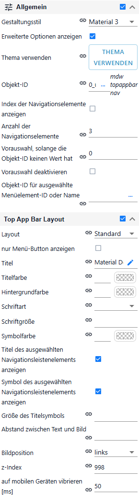
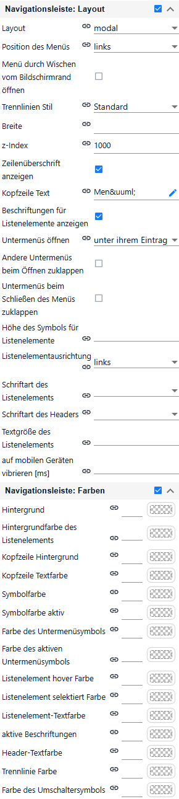
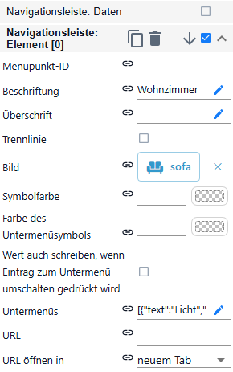
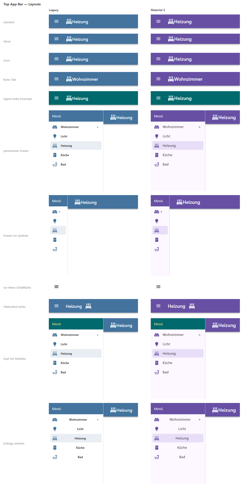
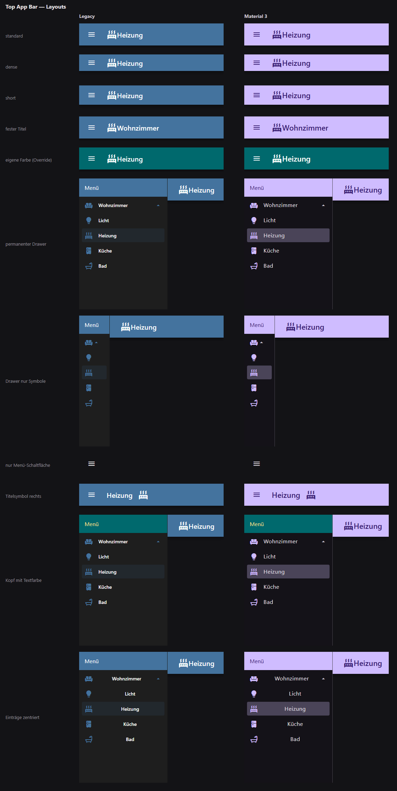

# Top App Bar

[Anwenderhandbuch](../README.md) › [Widget-Katalog](README.md) · [English](../../en/widgets/top-app-bar.md)

VIS-2-Top-App-Bar mit responsivem Navigation Drawer und indizierten Menüeinträgen.
Template-ID: `tplVis2-materialdesign-TopAppBar-Navigation`.

## Editor-Einstellungen

Die Screenshots zeigen die Allgemein-/Bar-Gruppen, Layout und Farben der
Navigationsleiste sowie die Menüdaten und einen
Eintrag. Nicht aufgeführte Einstellungen sind selbsterklärend.

**Allgemein**

- **Objekt-ID** – erhält den Index des gewählten Eintrags.
- **Objekt-ID für ausgewählte Menüelement-ID oder Name** – optionaler zweiter
  State; er erhält die **Menüpunkt-ID** des Eintrags, ersatzweise dessen
  Beschriftung. Bei einem Untereintrag steht dort der ganze Pfad, etwa
  `EG.Wohnzimmer.Licht`.
- **Index der Navigationselemente anzeigen** – stellt jeder Beschriftung im
  Drawer ihren Index als `[0]`, `[1]` … voran. Praktisch beim Verdrahten der
  eingebetteten Ansichten, danach wieder abschalten.
- **Anzahl der Navigationselemente** – Anzahl der indizierten Eintragsgruppen.
- **Vorauswahl, solange die Objekt-ID keinen Wert hat** – der Index, der bis zum
  ersten Menüklick ausgewählt ist; **Vorauswahl deaktivieren** lässt dann nichts
  ausgewählt.

**Top App Bar Layout**

- **Layout** – `standard`, `dense` oder `short`; die Werte stehen im Editor roh da.
- **nur Menü-Button anzeigen** – blendet Balken, Schatten und Titel aus, es
  bleibt nur der Menü-Button; der Rest der Breite lässt Klicks zu den Widgets
  darunter durch. Ohne eigene Symbolfarbe nimmt der Button die Textfarbe der
  Seite statt der Titelfarbe. Ein permanenter Drawer hat keinen Menü-Button,
  dann entfällt der Balken ganz.
- **Titel** – fester Titel, Vorgabe „Material Design Widgets“. Ein geleertes
  Feld bleibt leer.
- **Titel des ausgewählten Navigationsleistenelements anzeigen** (Vorgabe an)
  ersetzt ihn durch den aktiven Menüeintrag, **Symbol des ausgewählten
  Navigationsleistenelements anzeigen** stellt dessen Icon davor.
  **Abstand zwischen Text und Bild** (px) und **Bildposition** (`left` oder
  `right`) setzen Abstand und Seite dieses Icons.
- Farben und Schrift des Balkens setzen die Felder darunter, dazu **z-Index**
  (Vorgabe 998) für die Stapelreihenfolge gegenüber anderen Widgets.

Die Gruppe **Navigationsleiste: Layout** bestimmt das **Layout** des Drawers
(`modal`, `permanent` oder `auto` — `auto` bleibt bis zur unter **Layout 'auto':
automatische Änderung des Layouts bei Auflösung größer** gesetzten Breite modal,
Vorgabe 800 px), **Breite**, **Zeilenüberschrift anzeigen** samt **Kopfzeile
Text**, **Beschriftungen für Listenelemente anzeigen** (aus heißt: nur Symbole)
und den **Trennlinien Stil** (`standard`, `padded`, `inset`, ebenfalls roh).
**Andere Untermenüs beim Öffnen zuklappen** macht die Untermenüs zum Akkordeon:
Öffnet sich eines, klappen alle anderen zu, nur der Weg zu ihm bleibt offen. **Untermenüs beim Schließen des
Menüs zuklappen** zeigt jedes Untermenü beim nächsten Öffnen zugeklappt statt so,
wie es verlassen wurde. **Listenelementausrichtung** richtet
den Eintragstext aus, im Modus nur Symbole das Symbol. **Position des Menüs**
(`left` oder `right`) legt Menü-Button und Drawer gemeinsam an den linken oder
rechten Rand: Mit `right` steht der Button rechts neben dem Titel, und der Drawer
öffnet sich von rechts, etwa wenn die ioBroker-App oben links ihren eigenen
Button über den Menü-Button legt.
**Menü durch Wischen vom Bildschirmrand öffnen** (Vorgabe aus) öffnet einen
Drawer, der sich über die Ansicht legt, mit einem Wisch vom Bildschirmrand auf
seiner Seite (die äußeren 24 px) nach innen und schließt ihn mit einem Wisch
zurück zu diesem Rand. Ein dauerhafter Drawer und der Editor reagieren nicht
darauf. Auf Handys mit Gestensteuerung ist derselbe Wisch die System-Geste
„Zurück“, die Option passt deshalb eher zu Wandtablets im Kiosk-Modus als zu Handys.

Die drei Gruppen **Navigationsleiste: Farben**, **Untermenü-Layout** und
**Untermenüfarben** erscheinen erst mit dem Schalter **Erweiterte Optionen
anzeigen** in **Allgemein**. Dort setzt **Kopfzeile Textfarbe** die Schriftfarbe
der Drawer-Kopfzeile. **Symbolfarbe aktiv** und **Farbe des aktiven
Untermenüsymbols** färben das Symbol des gewählten Eintrags; für ein Untermenü
gilt ohne eigene Angabe **Symbolfarbe aktiv**. **Untermenü-Layout** und
**Untermenüfarben** gelten für die Untereinträge, darunter **Untermenü
Textausrichtung** und die Farbe der Untermenü-Trennlinie. Der **Hintergrund** in
**Untermenüfarben** liegt unter der Untermenüliste jeder Ebene; eine
halbtransparente Farbe wird deshalb mit jeder Ebene etwas kräftiger, was die
Ebenen voneinander abhebt.

Die Menüeinträge stammen aus den Daten- und Eintragsgruppen:

- **Eingabemethode für die Navigationselemente** – **über den Editor** (die
  indizierte Gruppe **Navigationsleiste: Element**) oder **JSON-String**. Bei
  JSON verschwindet die indizierte Gruppe, und **JSON-Sting für
  Navigationselemente** hält ein Array aus `{ "text", "menuId", "icon",
  "iconColor", "subMenuIconColor", "header", "divider", "subMenus", "url",
  "urlTarget" }`.
  `subMenuIconColor` färbt die Symbole aller Untereinträge darunter, bis ein
  tieferer Eintrag eine eigene Farbe setzt.
- **Menüpunkt-ID** – der Wert, den die zweite Objekt-ID für diesen Eintrag
  bekommt. Der Index in der ersten Objekt-ID hängt nicht daran.
- **Beschriftung / Überschrift / Trennlinie** – Eintragstext, ein Abschnittskopf
  über dem Eintrag und eine Trennlinie darunter.
- **Bild** samt Farben und **Untermenüs** – letzteres ein JSON-Array im selben
  Format wie oben. Ein Untereintrag kann selbst wieder `"subMenus"` haben
  (Gebäude → EG → Wohnzimmer, bis zu zehn Ebenen); jede Ebene ab der zweiten
  rückt ein Stück weiter ein. Ein Untereintrag bekommt sein Symbol mit
  `"icon"` (Farbe `"iconColor"`, sonst **Farbe des Untermenüsymbols** des
  Eintrags) und mit `"divider": true` eine Trennlinie darunter, zum Beispiel
  `[{ "text": "Wohnzimmer", "icon": "sofa", "divider": true }, { "text": "Küche", "icon": "fridge" }]`.
  Ein Eintrag mit Untermenü klappt beim Klick nur auf; **Wert
  auch schreiben, wenn Eintrag zum Untermenü umschalten gedrückt wird** schreibt
  zusätzlich seinen Index.
- **URL** / **URL öffnen in** – ein Eintrag mit URL öffnet diese Seite, statt
  eine View zu wählen, in `neuem Tab` oder `demselben Tab`; in die Objekt-IDs
  wird nichts geschrieben. Im JSON-String heißt das `"url"`, mit
  `"urlTarget": "_self"` für denselben Tab, auch bei Untereinträgen. Es öffnen nur
  Web-Adressen, `mailto:` und `tel:`; eine relative Adresse wie
  `/vis-2/?main#car` bleibt auf diesem Server.

## Gestaltungsstil

Die Stile **Klassisch** (links) und **Material 3** (rechts) nebeneinander, siehe
[Gestaltungsstil](../README.md#gestaltungsstil): die Layouts standard, dense und
short, fester Titel, eigene Farbe, permanenter Drawer, Drawer nur mit
Symbolen, nur die Menü-Schaltfläche, Titelsymbol rechts mit Abstand, Drawer-Kopf mit
eigener Textfarbe und zentrierte Einträge.

Dieselben Widgets bei eingeschaltetem Dark-Theme:

## Zwischen Ansichten umschalten

Die Top App Bar navigiert nicht selbst. Sie schreibt nur den Index des gewählten
Eintrags in ihre **Objekt-ID** (Eintrag 0 → `0`, Eintrag 1 → `1`, Untermenüs
zählen der Reihe nach mit: erst ein Eintrag, dann alle seine Untereinträge mit
deren Untereinträgen, dann der nächste Eintrag). Den Wechsel der Ansicht übernimmt ein
zweites Widget, das dieselbe Objekt-ID liest:
[Advanced View in Widget](html-widgets.md) in der `8`-Variante, mit einer
eingebetteten Ansicht je Index.

Der übliche Aufbau: die Top App Bar und darunter das Advanced View in Widget 8,
beide auf derselben Ansicht, beide mit derselben Objekt-ID. Das Widget muss so
hoch sein wie der Drawer, den es aufklappen soll — der leere Rest seines Rahmens
lässt Klicks zu den darunterliegenden Widgets durch.
