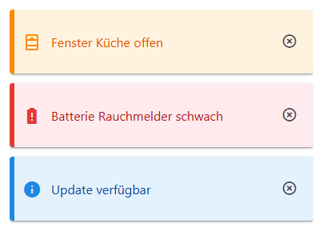
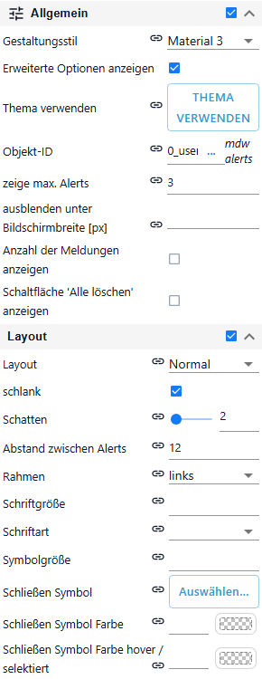
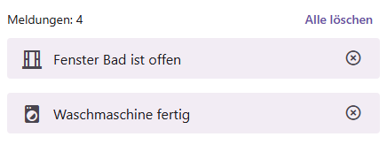
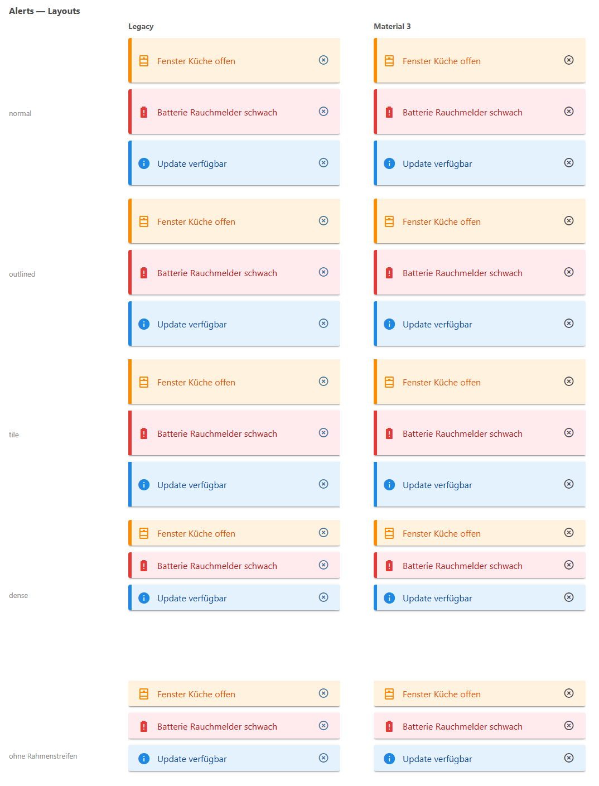
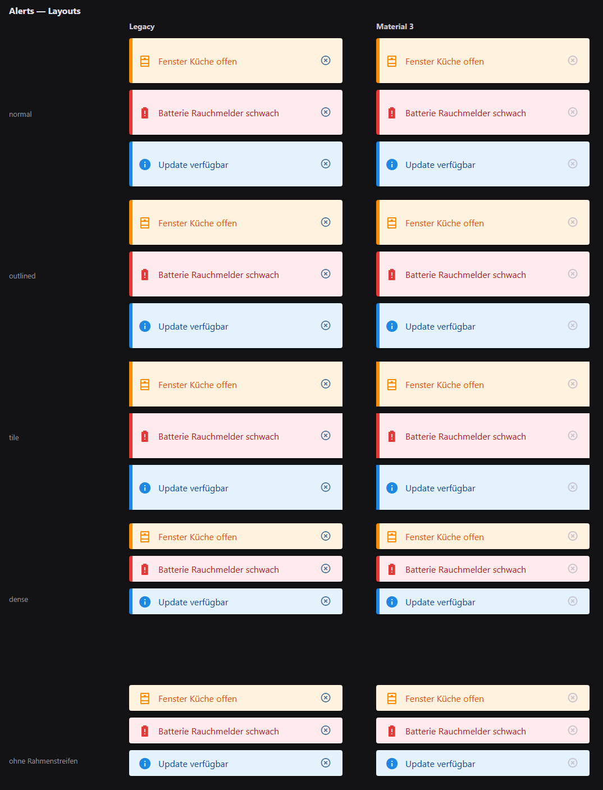

# Alerts

[User guide](../README.md) › [Widget catalog](README.md) · [Deutsch](../../de/widgets/alerts.md)

Displays a JSON alert queue as Material Design notices. Alerts can be closed and
the updated queue is written back to the state. Template id:
`tplVis2-materialdesign-Alerts`.



## Editor settings

The screenshot shows the **Common** and **layout** groups expanded. Settings not
listed below are self-explanatory. The editor UI follows the ioBroker system
language, so the screenshots are German.



**Common**

- **object id** – state holding the JSON alert array.
- **show max alerts** – how many alerts are shown at once, default 3. Empty or
  `0` shows every alert in the queue (100 at most).
- **hide below screen width [px]** – hides the widget below this screen width.
  The rule applies to this widget only, so several alerts widgets in one view can use different widths.
- **show number of alerts** – a line above the alerts with the number of all alerts in the state, also those beyond *show max alerts*.
- **show 'clear all' button** – a button in the same line that empties the state (`[]`). A state that is no valid JSON is never cleared.



In the editor an empty list shows two example alerts, so layout and colors can be set up. The editor never writes the state: closing an alert and clear all do nothing there, also for real alerts.

**layout**

- **layout** – `normal`, `outlined` or `tile`. The values are untranslated in
  the editor: `outlined` draws a border instead of a filled surface, `tile`
  removes the rounded corners.
- **slim / shadow / distance between alerts** – compactness (on by default),
  shadow depth 0–24 and the gap below each alert in pixels.
- **frame** – on which side each alert gets the 6 px colored stripe from
  `borderColor`: none, top, right, left or bottom.
- **icon close** / **icon close color** / **icon close color hover / selected** –
  the dismiss icon, its color and the color while it is held down. Closing
  removes the alert from the state.

```json
[
    {
        "text": "Window is open",
        "icon": "alert-outline",
        "backgroundColor": "#fff8e1",
        "borderColor": "#ffc107",
        "iconColor": "#ffc107",
        "fontColor": "#333333"
    }
]
```

Every property is optional. `text` may contain HTML (`<b>`, `<br>`, links);
scripts and event attributes are stripped before it is shown. `borderColor`
only has an effect while **frame** is not set to `none`.

The state must contain a JSON array. Invalid JSON is shown as an error in the
widget. An empty state shows nothing at all.

## Design style

The **Classic** (left) and **Material 3** (right) style side by side, see
[Design style](../README.md#design-style): the normal, outlined, tile and dense
layouts and an alert without the border stripe.



The same widgets with the dark theme switched on:


