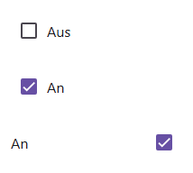
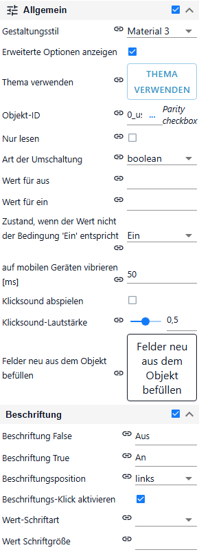
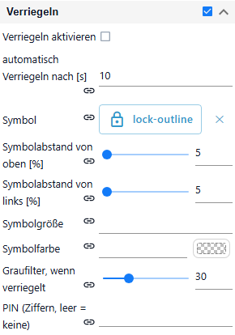
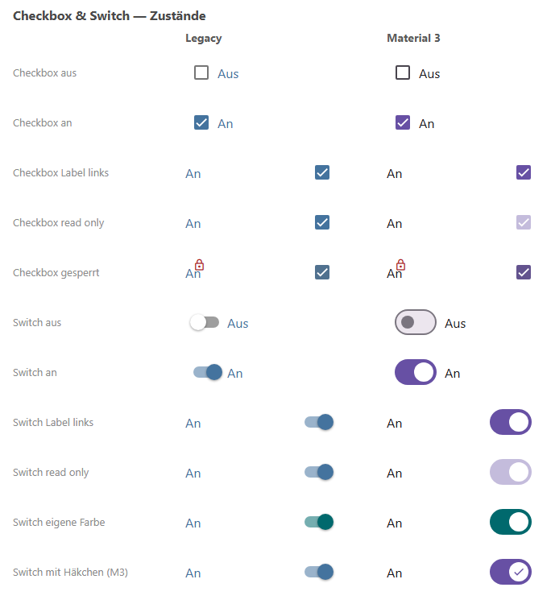
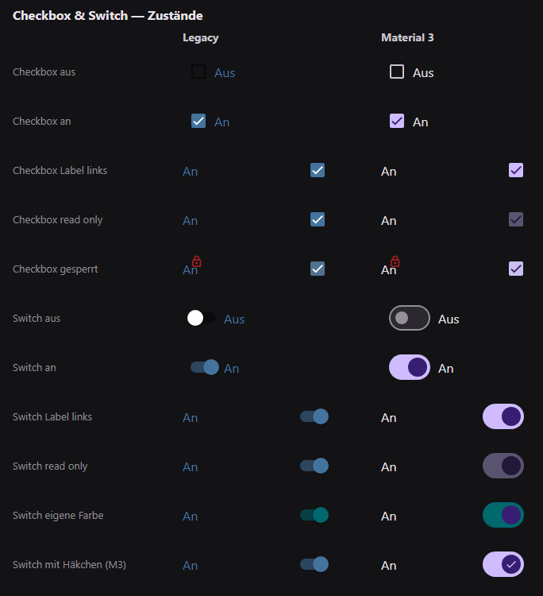

# Checkbox

[User guide](../README.md) › [Widget catalog](README.md) · [Deutsch](../../de/widgets/checkbox.md)

A native VIS 2 Material Design checkbox that reads and writes boolean or custom
off/on values. Template id: `tplVis2-materialdesign-CheckBox`.

## Editor settings

The screenshot shows the two relevant groups (**General** and **Label**)
expanded. Settings not listed below are self-explanatory. The editor UI follows
the ioBroker system language, so the screenshots are German.

**General**

- **type of toggle** – `boolean` reads and writes `true`/`false`; `Value` reads
  and writes **value for off** / **value for on** instead. Under `boolean` only
  a strict `true` counts as on, everything else is off.
- **state if value unequal to 'on' condition** – only applies to the `Value`
  toggle: `on` treats every value that is not the off value as on, `off` accepts
  only the exact on value.
- **vibrate on mobile devices [ms]** – haptic feedback duration on press in
  milliseconds (mobile only), default 50; `0` turns the vibration off.
- **Play click sound** / **Click sound volume** – click tone when switching and
  its volume from 0 to 1 (default 0.5).
- **read only** – shows the state but never writes it.

**Label**

- **Label false / Label true** – text shown next to the box in the off / on state.
- **Label position** – left, right or off.
- **activate label click** – lets a click on the label toggle the value, not
  only the box. On by default.
- **Value font / value font size** – font of the label.

The **colors** group controls **checkbox color**, **border color**, **hover
color of checkbox**, **label color** and **active label color**.

**Locking** puts a lock over the widget: **enable Locking** switches it on, a
click on the icon unlocks, and **auto Locking after [s]** (default 10) locks
again. **gray filter if locked** (default 30 %) fades the locked widget; for its
**icon** you can select an icon or an image, and **symbol distance from top /
left [%]** places it.

## Read only, locking and PIN

**Read only** can be bound to a state: the checkbox next to it and vis-2's binding symbol switch the field to a binding. `{0_userdata.0.automatik}` blocks the widget while the state is on; `{a:0_userdata.0.automatik;!a}` inverts that and blocks it while the state is off. A bound string `true` or `1` counts as on.  Read only always wins over the lock: a read-only widget reacts to nothing and opens no PIN pad. Autofill ticks the box only for a non-writable object and never overwrites a binding.

**PIN** (all widgets with a lock): 1 to 12 digits, empty means no PIN. With a PIN, a tap on the lock opens a pad with the keys 1 to 9, Cancel, 0 and Delete; it checks as soon as the PIN is complete, shakes and clears on a wrong PIN. A hardware keyboard works too (digits, Backspace, Escape). The right PIN unlocks every widget with the same PIN in this browser until the lock time ends; a reload locks everything again. The PIN can be bound to a state to keep one central PIN. If the bound PIN is empty or not 1 to 12 digits, the widget stays locked and the pad says "PIN not set up". A numeric state loses leading zeros (0123 becomes 123); use a string state for such PINs. In the editor the pad never opens.

**Not a security feature:** the PIN stands in clear text in the project and in the state, and anyone who can write states bypasses every lock. It protects against accidental taps and children, not against attackers.

## Design style

The **Classic** (left) and **Material 3** (right) style side by side, see
[Design style](../README.md#design-style): checkbox and switch: off, on, label
on the left, read-only, locked, an explicit color and the Material 3 check mark
inside the switch handle.

The same widgets with the dark theme switched on:

