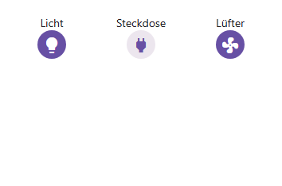
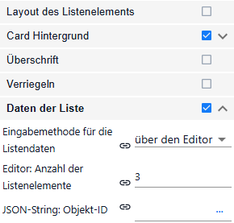
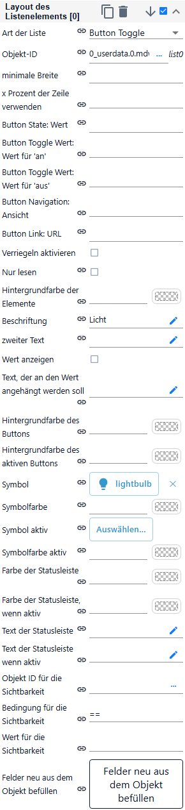
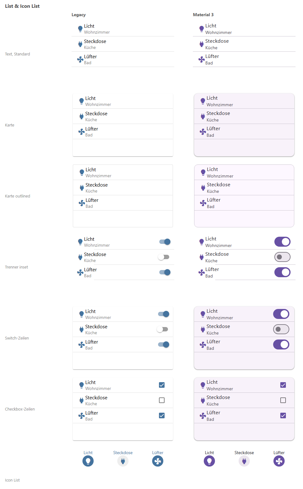
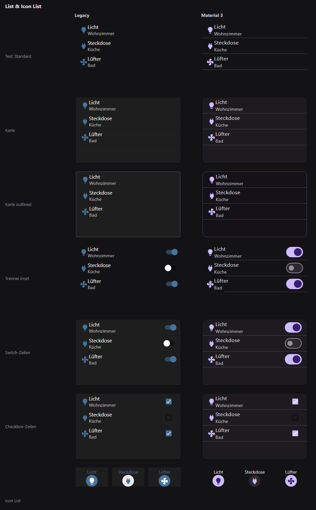

# IconList

[User guide](../README.md) › [Widget catalog](README.md) · [Deutsch](../../de/widgets/iconlist.md)

Displays state-dependent icons in a responsive VIS 2 icon grid. Data can be
entered in the editor or read from JSON. Template id:
`tplVis2-materialdesign-Icon-List`.

## Editor settings

The screenshots show the data groups and the grid layout. Settings not listed
below are self-explanatory. The editor UI follows the ioBroker system language,
so the screenshots are German.

**data of list**

- **input method for the list data** – `via editor` or `JSON string`.
- **Editor: count of list items** – how many indexed item groups exist.
- **JSON-String: object id** – the state holding the JSON array, only for the `JSON string` method.

Each cell is configured in its own indexed **layout of list item [n]** group.
Unlike the [List](list.md), **every cell carries its own type**:

- **type of list** – `text`, `Button State`, `toggle Button`,
  `Button Toggle Value: is only on if …`, `Button Toggle Value: is only off if …`,
  `Button Navigation` or `Button Link`. Without a matching comparison value a cell
  counts as active as soon as its state is `true`.
- **oid** – state that drives the cell.
- **Read only** – shows the state but writes nothing.
- **icon / icon color** and **icon active / icon active color** – off- and on-state of the icon; without active values the normal ones stay.
- **Label / second text** – the texts on the cell.
- **show value** (on by default) shows the state value, **text to append to value** adds a unit.
- **status bar color (if active) / text of status bar (if active)** – narrow strip along the bottom of the cell.
- **minimal width** and **use x percent of row** – width of this one cell, apart from the grid.
- **object id for visibility**, **condition for visibility** and **value for visibility** – hide the cell while the condition does not hold. Accepted are `==` (default), `!=`, `<`, `<=`, `>`, `>=`, `consist`, `not consist`, `exist` and `not exist`. Without an object id the cell stays visible.
- **enable Locking** – this cell has to be unlocked before it switches.

**Locking** (list-wide)

- **auto Locking after [s]** – 10 seconds by default.
- **icon**, position, size and color of the lock.
- **gray filter if locked** (30 % by default) and **apply grayfilter only on icon**.

The grid arrangement lives in the **Common** group:

- **wrap items** / **count of maximum list items per row** – how cells flow into rows.
- **distance between items** – spacing between cells.
- **scroll to the active entry** – when another entry becomes active, the list
  scrolls inside its own box until that entry is visible. The view and the page
  around the widget stay where they are.

The **layout of list item** group holds **layout** (`standard`, `card`,
`cardOutlined`), **layout of elements** (`vertical` or `horizontal` — icon above
or beside the text), **image height**, **minimal width / height**, **layout of
buttons** (`round`, `square`, `complete`) plus the fonts and colors of the three
text lines.

Icons accept Material Design icon names and image sources.

With the `JSON string` method the state holds an array of objects whose keys
differ from the editor fields: `objectId`, `text`, `subText`, `image`,
`imageColor`, `imageActive`, `imageActiveColor`, `background`,
`buttonBackgroundColor`, `buttonBackgroundActiveColor`, `buttonStateValue`,
`buttonToggleValueTrue`, `buttonToggleValueFalse`, `buttonNavView`, `buttonLink`;
`listType`, `minWidth`, `usePercentOfRow`, `readOnly`, `showValueLabel`,
`valueAppendix`, `statusBarColor`, `statusBarColorActive`, `statusBarText`,
`statusBarTextActive`, `lockEnabled`, `visibilityOid`, `visibilityCondition` and
`visibilityConditionValue` are named as in the editor. Anything past 100 entries
is cut off.

## Read only, locking and PIN

**Read only** can be bound to a state: the checkbox next to it and vis-2's binding symbol switch the field to a binding. `{0_userdata.0.automatik}` blocks the widget while the state is on; `{a:0_userdata.0.automatik;!a}` inverts that and blocks it while the state is off. A bound string `true` or `1` counts as on. Applies per entry. Read only always wins over the lock: a read-only widget reacts to nothing and opens no PIN pad. A read-only widget shows no lock icon. Autofill ticks the box only for a non-writable object and never overwrites a binding.

**PIN** (all widgets with a lock): 1 to 12 digits, empty means no PIN. With a PIN, a tap on the locked widget opens a pad with the keys 1 to 9, Cancel, 0 and Delete; it checks as soon as the PIN is complete, shakes and clears on a wrong PIN. A hardware keyboard works too (digits, Backspace, Escape). The right PIN unlocks every widget with the same PIN in this browser until the lock time ends; a reload locks everything again. The PIN can be bound to a state to keep one central PIN. If the PIN is not 1 to 12 digits, or a bound PIN is empty, the widget stays locked and the pad says "PIN not set up". The editor already marks a typed invalid PIN in red; correct or clear it there. A numeric state loses leading zeros (0123 becomes 123); use a string state for such PINs. In the editor the pad never opens.

**Not a security feature:** the PIN stands in clear text in the project and in the state, and anyone who can write states bypasses every lock. It protects against accidental taps and children, not against attackers.

## Design style

The **Classic** (left) and **Material 3** (right) style side by side, see
[Design style](../README.md#design-style): the plain text list, the card and
outlined card layout, inset dividers, switch and checkbox rows and the icon
list.

The same widgets with the dark theme switched on:

