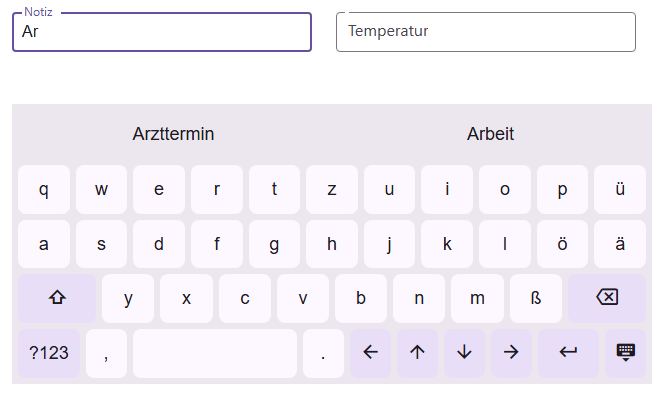
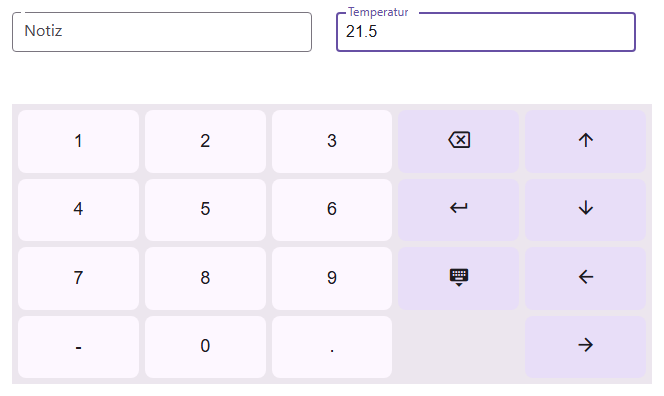
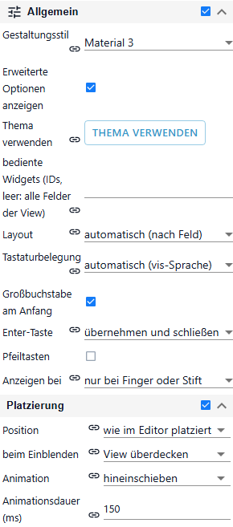
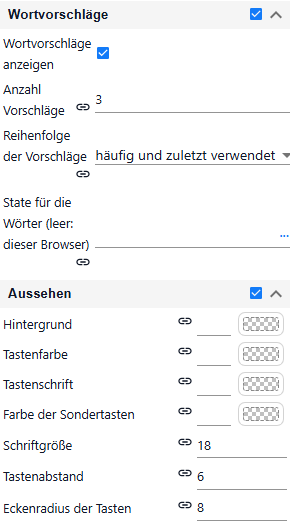
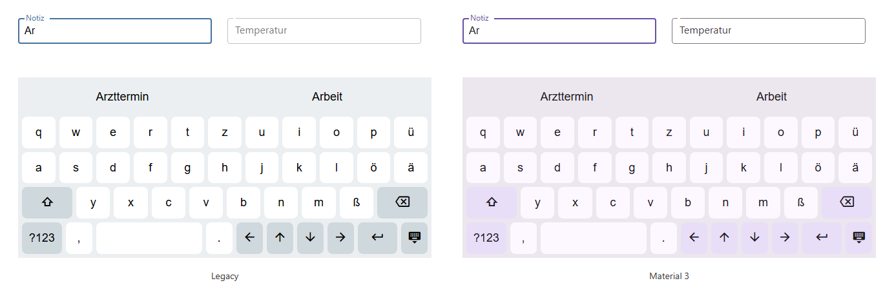
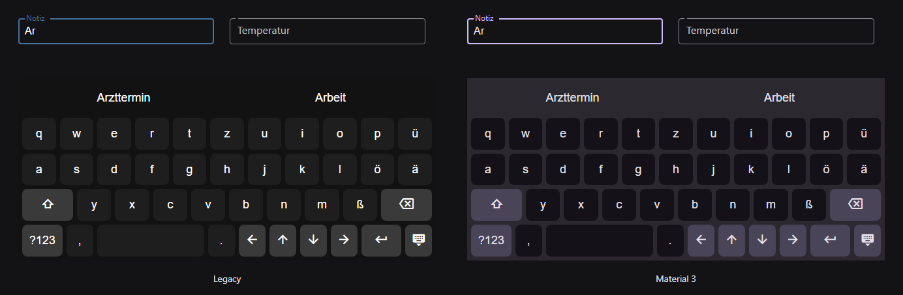

# On-screen Keyboard

[User guide](../README.md) › [Widget catalog](README.md) · [Deutsch](../../de/widgets/keyboard.md)

A keyboard inside the vis page for wall tablets, where the Android keyboard covers half of the
screen. It serves the text fields of its view, keeps the system keyboard closed for them and
shows itself only while one of them has the focus. Template id: `tplVis2-materialdesign-Keyboard`.

On a number field it shows the number pad:

## Editor settings

The editor UI follows the ioBroker system language, so the screenshots are German.

**Common**

- **served widgets** – widget IDs (for example `w000012 w000013`); empty serves every text field of
  the view the keyboard is placed in. Checkboxes, native date and time fields, read-only and
  disabled fields are never served.
- **layout** – `automatic` shows the number pad for number fields and fields that ask for digits
  (the Input widget's date and 24 h time fields do), the letters otherwise; `text` and `numbers`
  force one.
- **key map** – `automatic` follows the vis language: German gets QWERTZ with ä, ö, ü and ß, every
  other language QWERTY.
- **capital letter at the start** – shift is on in an empty field and after `. `.
- **Enter key** – `commit and close`, `next field` (closes after the last one) or `commit only`.
  Enter commits in a multi-line field as well and does not insert a line break. `next field`
  follows the order of the fields in the page (the order the widgets were created in), not their
  position on the screen. Enter sends `keydown`, `keypress` and `keyup` with key code 13, so widgets
  of other adapters that wait for Enter (for example the Bring shopping list) react as to a real key.
- **arrow keys** – adds ← ↑ ↓ → keys (on the number pad a fifth column). ← and → move the cursor;
  ↑ and ↓ move through the list of an Autocomplete widget, in any other field they jump to the start
  or the end. Holding a key repeats it.
- **show on** – `touch or pen only` (default) or `every focus`. On a PC with mouse and keyboard the
  keyboard stays closed by default, and the fields stay as they are (number fields keep their
  arrows) until a finger or pen touches the screen. A tap into a field that already has the focus
  from a mouse click opens the keyboard as well.

**placement**

- **position** – `as placed in the editor` (the widget's own rectangle), `bottom of the view`,
  `top of the view` (both the full view width and the widget height) or `bottom of the screen`.
- **on showing** – `cover the view`, `move the view up` (only as far as needed to keep the field
  8 px above the keyboard) or `add room and scroll` (the scrolling container gets room below and
  scrolls the field into sight; in a Dialog View turn on **scrollY**, otherwise the room is cut off).
  The last two only act when the keyboard is below the field, so they are meant for the bottom
  positions; a keyboard at the top of the view covers the view, whatever is chosen.
- **animation** and **animation duration** (0 to 2000 ms) – how the keyboard appears; hiding is
  immediate.

**word suggestions**

- **show word suggestions** – a bar above the keys with the most typed words; while a word is
  started, only words that begin with it. Tap fills the word in and adds a space; a long press
  removes the word from the list (for learned typos).
- **number of suggestions** – 1 to 10.
- **state for the words** – a string state that keeps the list as JSON, shared by every device that uses
  it. Empty keeps the list in this browser only. Words are learned when a field is left or Enter
  commits, never from password fields or the number pad, at most 200 words of at most 40
  characters. Anyone with admin access can read the words in the state.

**look** – background, key colors, font size (8 to 64), key gap (0 to 32) and corner radius (0 to
64). The special key color paints ⇧, ⌫, ↵, ⌄, `?123`/`ABC` and the arrow keys; space and the
decimal key look like the letter keys. Unset colors follow the Material 3 theme.

## Design style

The **Classic** (left) and **Material 3** (right) style side by side, see
[Design style](../README.md#design-style), each with a typed word and its
suggestions. Unset colors follow the style and the dark theme.

The same keyboards with the dark theme switched on:

## Notes

- Fields in other views are not served; place a keyboard there too. Use one keyboard per view.
- A view shown inside this view (Dialog View, view in widget) belongs to it. When that inner view has
  a keyboard of its own, that keyboard serves the inner fields and this one leaves them alone, so
  only one keyboard opens.
- Two devices learning into the same state at the same moment can lose one count.
