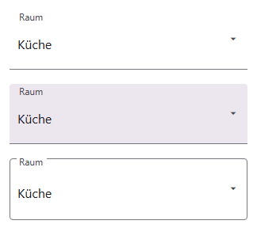
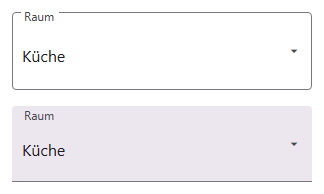
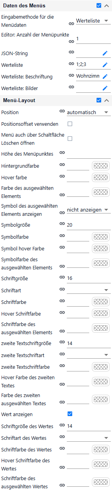
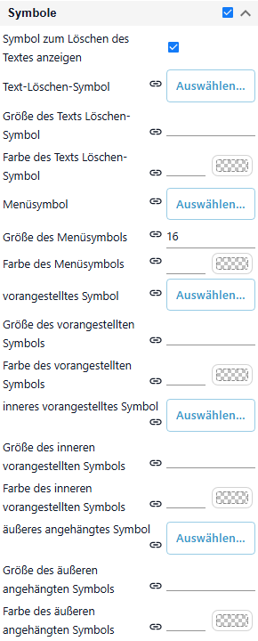
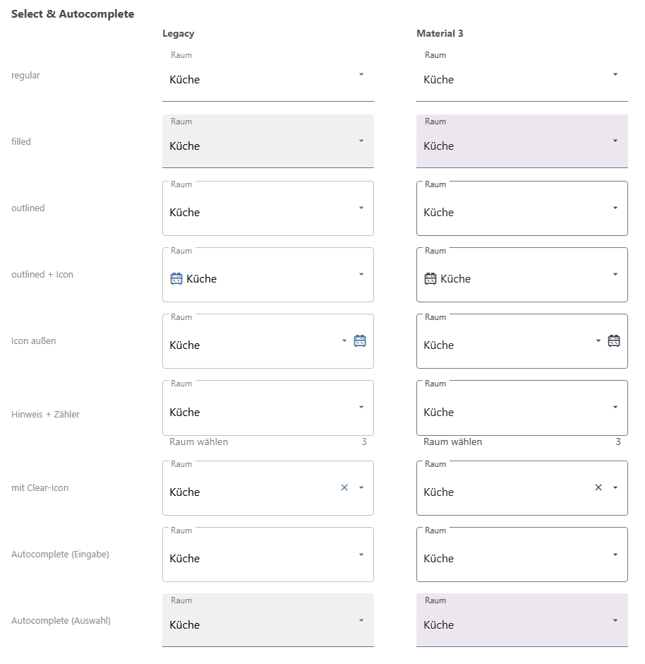
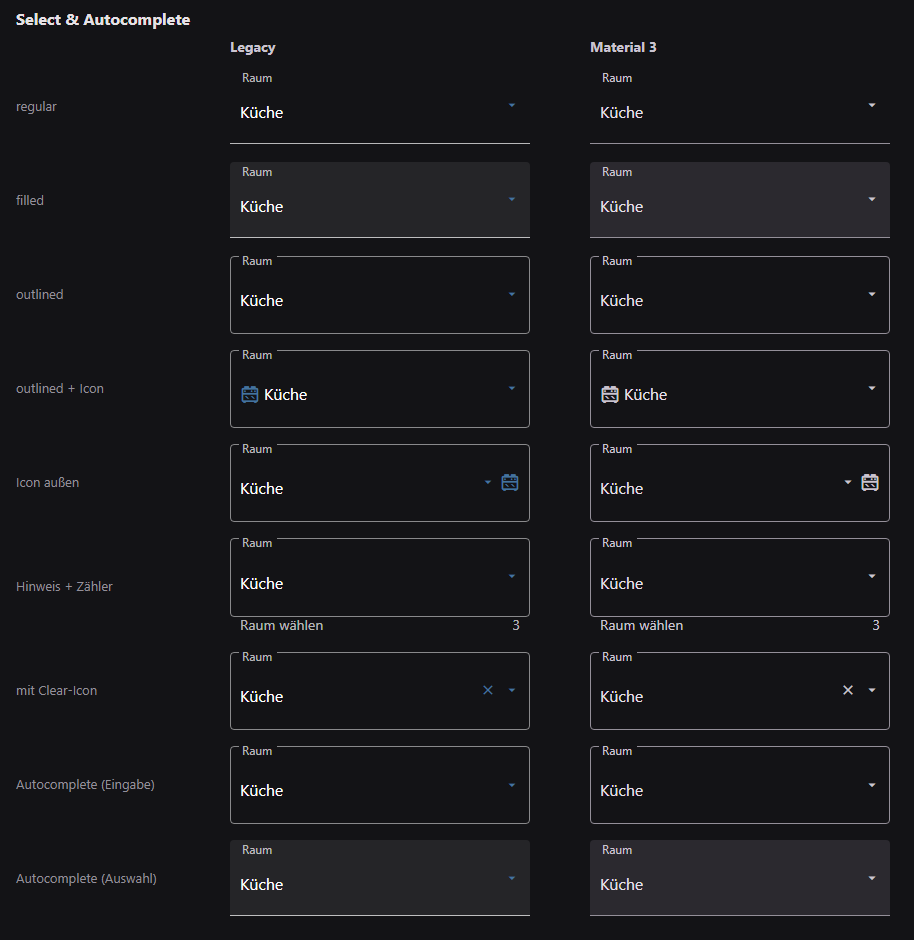

# Select and Autocomplete

[User guide](../README.md) › [Widget catalog](README.md) · [Deutsch](../../de/widgets/select.md)

Native VIS 2 dropdowns for choosing a value. Autocomplete behaves like Select but
also filters the entries while you type.

Template ids: `tplVis2-materialdesign-Select` and `tplVis2-materialdesign-Autocomplete`.

Autocomplete uses the same settings but filters the list as you type — handy for
long value lists such as cities or titles.

## Editor settings

The screenshot shows the menu groups expanded. Settings not listed below are
self-explanatory. The editor UI follows the ioBroker system language, so the
screenshots are German.

**Common**

- **Object ID** – the state the selection is written to and the displayed value
  is read from.
- Autocomplete only: **input mode** – `write` turns the field into a free text
  field with suggestions: it also shows a value that is in no entry, keeps the
  text on focus so you can edit it, and writes exactly the typed text into the
  state when you leave the field or press Enter. An entry is only taken when you
  tap it, highlight it with the arrow keys, or its text equals the typed text
  (ignoring case). Focusing the field and leaving it again writes nothing.
  `select` only takes entries of the list and discards free text.
- Autocomplete only: **input type** – `text`, `date` or `time` for the input field.
- Autocomplete only: **open the menu from n typed characters** – the menu only
  opens once that many characters are typed. `0` (default) opens it on focus.
  The arrow keys always open it.

**data of menu**

- **input method for the menu data** – `via editor` (indexed **menu item [n]**
  groups), `JSON string`, `Object has multistate` (the `states` of the object
  behind the object id) or `value list`.
- **Editor: count of menu items** – how many indexed **menu item [n]** groups exist.
- **value list / value list: labels / value list: images** – three
  semicolon-separated lists read position by position, e.g. values `1;2;3`,
  labels `Living room;Kitchen;Bath`, images `sofa;silverware-fork-knife;shower`.
  Without a label the value itself is shown.
- **JSON string** – an array of objects with `value`, `text`, `subText`, `icon`,
  `iconColor` and `iconColorSelectedTextField`. An entry without `value` is
  skipped, one without `text` shows its value.

**menu layout**

- **position / use position offset** – whether the menu opens `auto`, `top` or
  `bottom`.
- **open Menu at using clear button** – clearing the value opens the list again.
- **show icon of selected item** – where in the input field the selected entry's
  icon appears: `don't display`, `prepend`, `prepend-inner` or `append-outer`. It
  replaces the fixed icon in that slot.
- **show value** – each menu row also shows its value to the right of the text.
- Row height, fonts and colors of the list each cover the normal, hovered and
  selected state.

**menu item [n]**

These groups only appear for the `via editor` method.

- **Value** – what is written into the state. Left empty, the **Label** is written.
- **Label / second text** – the two text lines of the entry.
- **icon / icon color** – the icon of the menu row.
- **selected icon color for textfield** – the color of that same icon once it sits
  in the input field as the selected entry.

The **layout input** group (`regular`, `solo`, `solo-rounded`, `solo-shaped`,
`filled`, `filled-rounded`, `filled-shaped`, `outlined`, `outlined-rounded`,
`outlined-shaped`) matches the [Input](input.md) widget, as do **label of input**,
**appendixs of the input**, **sub text of input** and **counter layout**.

**icons**

The **text delete icon**, the **menu open symbol** (the collapse arrow), the
**prefixed icon**, the **inner prefixed symbol** and the **outer appended symbol**
each take an icon or an image plus size and color.

## Keyboard (Autocomplete)

The focus stays in the input field; the list is operated with one highlight.

- **↓ / ↑** – opens the menu and moves the highlight; it wraps at the ends.
- **Enter** – takes the highlighted entry. Without a highlight, `write` writes the
  typed text and `select` the first matching entry.
- **Tab** – takes the highlighted entry and moves on.
- **Escape** – closes the menu and discards the typed text; the value stays. A dialog around the widget stays open; only a second Escape reaches it.

While an on-screen keyboard is still composing a word, Enter and Tab do nothing.
When the typed text matches no entry, the menu stays closed.

## Design style

The **Classic** (left) and **Material 3** (right) style side by side, see
[Design style](../README.md#design-style): the regular, filled and outlined
layouts, entries with icons, the value column, the clear icon, plus autocomplete
while typing and after picking an entry.

The same widgets with the dark theme switched on:

