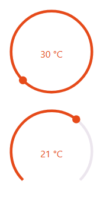
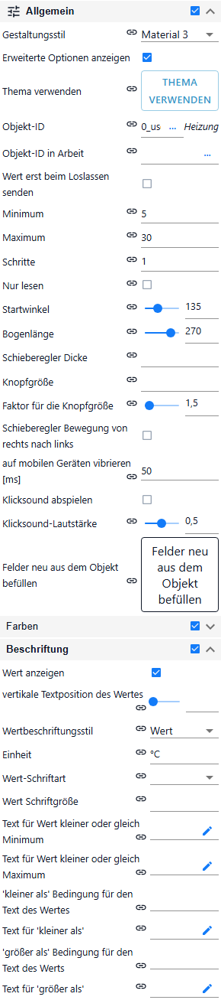
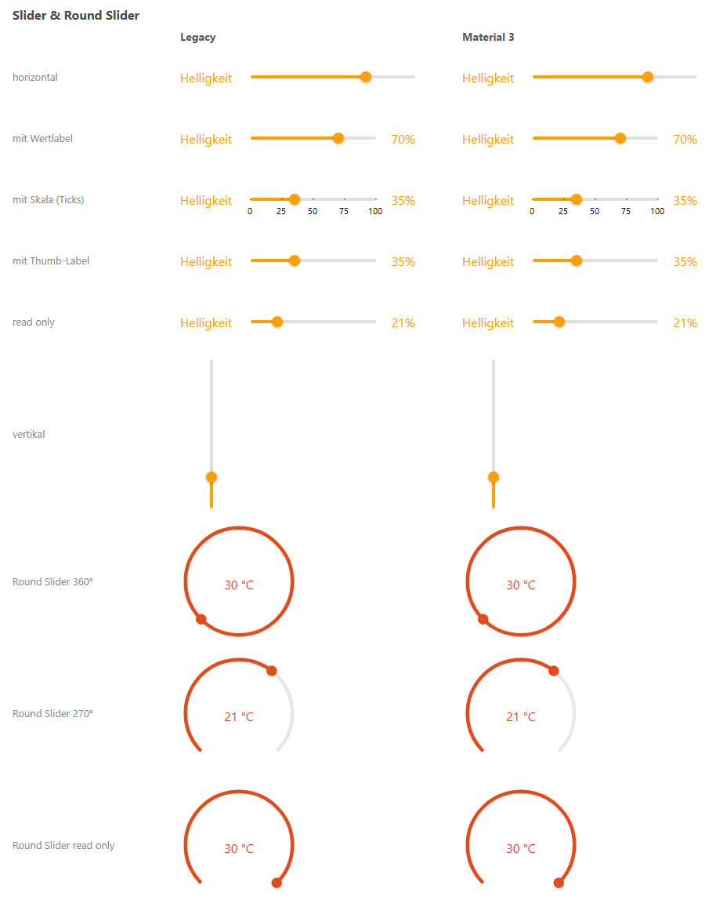
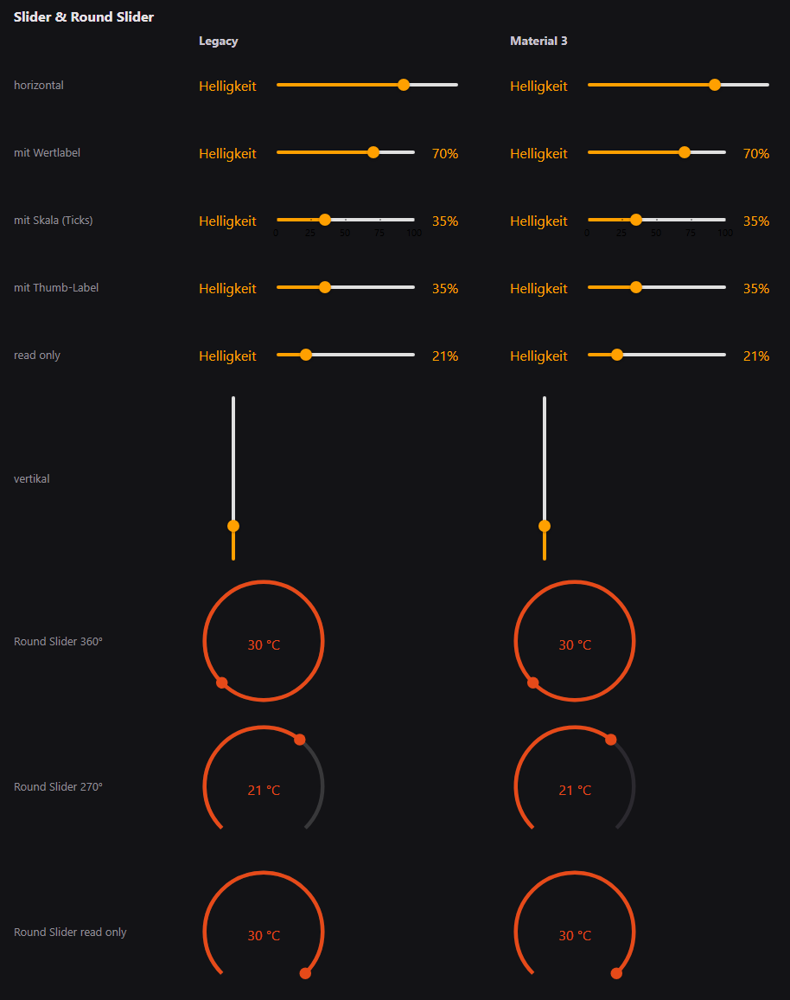

# Slider Round

[User guide](../README.md) › [Widget catalog](README.md) · [Deutsch](../../de/widgets/slider-round.md)

A circular native VIS 2 slider for numeric states. Template id:
`tplVis2-materialdesign-Slider-Round`.

## Editor settings

The screenshot shows the **Common** and **labeling** groups expanded. Settings not
listed below are self-explanatory. The editor UI follows the ioBroker system
language, so the screenshots are German.

**Common**

- **Object ID** – value state; **working object ID** disables the slider while
  that state reports the device is still moving.
- **Minimum / Maximum / steps** – value range and increment (1 by default).
- **Send value on release** – writes once at the end of the drag instead of
  continuously; the knob follows the finger either way.
- **start angle / arc length** – where the circular track begins (135° by
  default) and how many degrees it sweeps (270° by default).
- **slider thickness** (3 by default) and **knob size** (6 by default) count in
  percent of the widget edge, not in pixels — the drawing sits in a 100×100 grid.
- **knob size factor** – multiplies the knob size permanently, 1.5 by default.
- **slider movement from right to left** – reverses the direction.
- **Read only** – shows the value without accepting input.

**labeling**

- **show value** – value label in the center, on by default; **vertical text
  position of value** moves it up or down.
- **value caption style / unit** – `value` appends the unit to the raw value,
  `percent` shows the floored percentage instead and drops the unit.
- **text for value less or equal than minimum** applies from the minimum down;
  **text for value less or equal than maximum**, despite its label, applies from
  the **maximum** up.
- **'smaller than' condition for the text of the value** / **text for 'smaller
  than'** – the text shows between the minimum (exclusive) and that limit
  (inclusive); **'greater than' condition for the text of the value** / **text
  for 'greater than'** likewise from that limit up to just below the maximum.

The **colors** group (**background**, **color before regulator**, **color of
regulator**, **color after regulator**, **text color of value**) only appears
once **show advanced options** is ticked in **Common**.

## Read only, locking and PIN

**Read only** can be bound to a state: the checkbox next to it and vis-2's binding symbol switch the field to a binding. `{0_userdata.0.automatik}` blocks the widget while the state is on; `{a:0_userdata.0.automatik;!a}` inverts that and blocks it while the state is off. A bound string `true` or `1` counts as on. Only the binding is new; the round slider shows no lock icon while read-only. Read only always wins over the lock: a read-only widget reacts to nothing and opens no PIN pad. Autofill ticks the box only for a non-writable object and never overwrites a binding.

**Locking** (group under **show advanced options**): **enable Locking**, **auto Locking after [s]** (1 s to 24 h, default 10), **PIN**, **icon** and **icon color**. New for the round slider. A tap unlocks without moving the knob. A drag in progress is never locked under your fingers; the widget locks once it ends.

**PIN** (all widgets with a lock): 1 to 12 digits, empty means no PIN. With a PIN, a tap on the lock opens a pad with the keys 1 to 9, Cancel, 0 and Delete; it checks as soon as the PIN is complete, shakes and clears on a wrong PIN. A hardware keyboard works too (digits, Backspace, Escape). The right PIN unlocks every widget with the same PIN in this browser until the lock time ends; a reload locks everything again. The PIN can be bound to a state to keep one central PIN. If the bound PIN is empty or not 1 to 12 digits, the widget stays locked and the pad says "PIN not set up". A numeric state loses leading zeros (0123 becomes 123); use a string state for such PINs. In the editor the pad never opens.

**Not a security feature:** the PIN stands in clear text in the project and in the state, and anyone who can write states bypasses every lock. It protects against accidental taps and children, not against attackers.

## Design style

The **Classic** (left) and **Material 3** (right) style side by side, see
[Design style](../README.md#design-style): the horizontal slider with value
label, ticks and thumb label, read-only, vertical, plus the round slider at 360°
and 270° and read-only.

The same widgets with the dark theme switched on:

