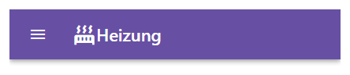
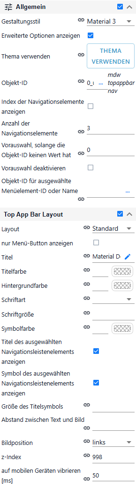
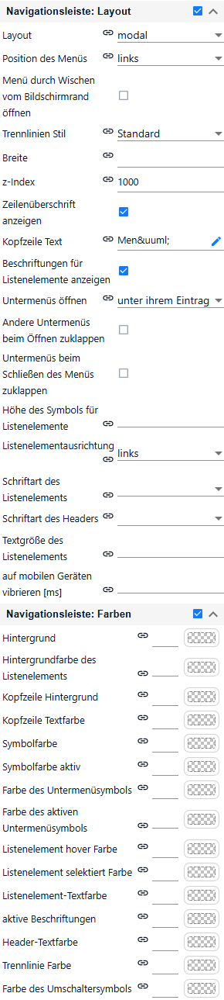
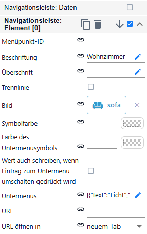
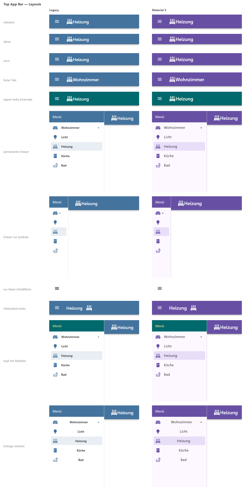
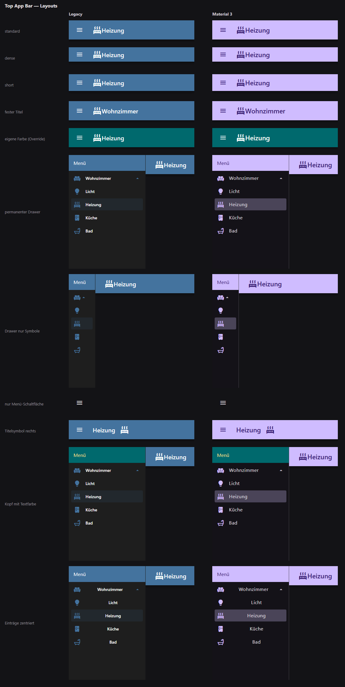

# Top App Bar

[User guide](../README.md) › [Widget catalog](README.md) · [Deutsch](../../de/widgets/top-app-bar.md)

A VIS 2 top app bar with responsive navigation drawer and indexed menu items.
Template id: `tplVis2-materialdesign-TopAppBar-Navigation`.

## Editor settings

The screenshots show the general/bar groups, the drawer layout and colors, and
the menu data plus one item.
Settings not listed below are self-explanatory. The editor UI follows the
ioBroker system language, so the screenshots are German.

**Common**

- **Object ID** – receives the index of the selected entry.
- **Object Id for selected menu item id or name** – optional second state; it
  receives the entry's **menu item id**, falling back to its label. For a
  submenu entry it holds `parent.child`.
- **show index of navigation items** – prefixes every drawer label with its
  index as `[0]`, `[1]` … Handy while wiring the embedded views, switch it off
  afterwards.
- **count of navigation items** – number of indexed item groups.
- **preselected index while the object ID has no value** – the index selected
  until the first menu click; **disable preselection** leaves nothing selected
  instead.

**top app bar layout**

- **layout** – `standard`, `dense` or `short`; the values are untranslated in
  the editor.
- **show only the menu button** – hides the bar, its shadow and the title and
  leaves only the menu button; the rest of the width lets clicks through to the
  widgets below. Without an icon color of its own the button takes the text
  color of the page, not the title color. A permanent drawer has no menu
  button, so the bar is gone entirely then.
- **title** – fixed title, "Material Design Widgets" by default. A cleared field
  stays empty.
- **show title of selected navigation bar item** (on by default) replaces it
  with the active menu entry, **show icon of selected navigation bar item** puts
  that entry's icon in front of it. **distance between text and image** (px)
  and **image position** (`left` or `right`) set the gap to that icon and its
  side.
- The fields below set the bar's colors and font, plus a **z-index** (998 by
  default) for stacking against other widgets.

The **navigation bar layout** group sets the drawer **layout** (`modal`,
`permanent` or `auto` — `auto` stays modal up to the width in **layout 'auto':
layout auto change on resoltuion higher than**, 800 px by default), its
**width**, **show row heading** with **header text**, **show list items labels**
(off means icons only) and the **divider style** (`standard`, `padded`, `inset`,
untranslated as well). **close other submenus when one opens** turns the
submenus into an accordion: when one opens, all others close. **close
submenus when the menu closes** shows every submenu closed each time the menu
opens again, instead of as it was left. **list item
alignment** aligns the entry text, or the icon when only icons are shown.

The three groups **navigation bar colors**, **sub menu layout** and **sub menu
colors** only appear once **show advanced options** is ticked in **Common**.
**header text color** in **navigation bar colors** sets the color of the
drawer header text. **active icon color** and **active submenu icon color**
color the icon of the selected entry; a submenu entry without its own value
uses **active icon color**. **sub menu layout** and **sub menu colors** apply to
the submenu entries, including **submenu text alignment** and the color of the
submenu divider.

Menu entries come from the data and item groups:

- **input method for the navigation items** – **via editor** (the indexed **item
  of navigation bar** group) or **JSON string**. With JSON the indexed group
  disappears and **JSON Sting for navigation items** holds an array of
  `{ "text", "menuId", "icon", "iconColor", "subMenuIconColor", "header",
  "divider", "subMenus", "url", "urlTarget" }`. `subMenuIconColor` colors the icons
  of this entry's submenu entries.
- **menu item id** – the value the second object id receives for this entry. The
  index in the first object id does not depend on it.
- **label / header / divider** – entry text, a section heading above the entry
  and a separator below it.
- **icon** with its colors and **submenus** – the latter a JSON array in the
  same format as above, one level deep. A submenu entry gets its icon from
  `"icon"` (color `"iconColor"`, otherwise the entry's **sub menu icon color**)
  and a separator below it from `"divider": true`, for example
  `[{ "text": "Living room", "icon": "sofa", "divider": true }, { "text": "Kitchen", "icon": "fridge" }]`.
  An entry with a submenu only expands on click; **set
  value on click at item that toggle submenu** also writes its index.
- **URL** / **open URL in** – an entry with a URL opens that page instead of
  selecting a view, in a `new tab` or the `same tab`; nothing is written to the
  object ids. In the JSON string this is `"url"` with `"urlTarget": "_self"` for
  the same tab, also on submenu entries. Only web addresses, `mailto:` and
  `tel:` open; a relative address such as `/vis-2/?main#car` stays on this
  server.

## Design style

The **Classic** (left) and **Material 3** (right) style side by side, see
[Design style](../README.md#design-style): the standard, dense and short
layouts, a fixed title, an explicit color override, a permanent drawer, an icon-only
drawer, only the menu button, the title icon on the right with a gap, a drawer
header with its own text color and centered entries.

The same widgets with the dark theme switched on:

## Switching views

The top app bar does not navigate by itself. It only writes the index of the
selected entry into its **object id** (entry 0 → `0`, entry 1 → `1`, submenus
count in the same order). A second widget reading that same object id performs
the view change: [Advanced View in Widget](html-widgets.md), the `8` variant,
with one embedded view per index.

The usual setup: the top app bar and, below it, the Advanced View in Widget 8 —
both on the same view, both with the same object id. The bar widget has to be as
tall as the drawer it opens; the empty rest of its box lets clicks through to the
widgets underneath.
